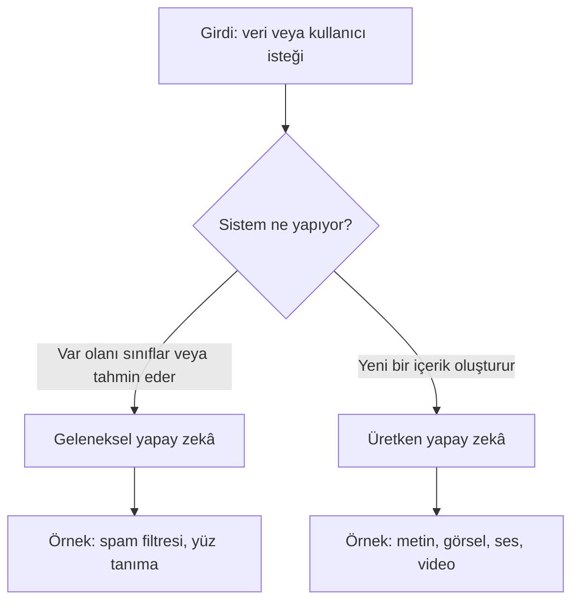
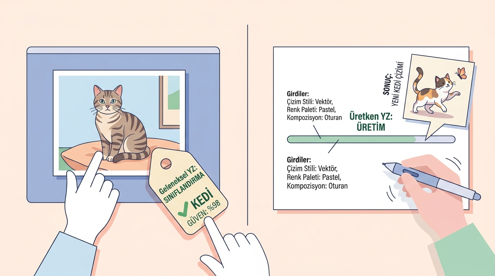

# Üretken Yapay Zekâya Giriş

## 🎯 Bu Bölümde Ne Öğreneceğiz?

- Üretken yapay zekânın ne olduğunu tanımlayacaksın.
- Üretken yapay zekâyı geleneksel yapay zekâdan ayırt edeceksin.
- Üretken yapay zekânın günlük hayatta ve sağlık alanında nerelerde karşına çıktığını göreceksin.
- Elindeki bir aracın üretken olup olmadığını değerlendireceksin.

## 💡 Neden Bu Konuyu Öğreniyoruz?

Yapay zekâ artık laboratuvarlarda kalan bir konu değil. Bir ödev taslağı yazarken, bir görsel oluştururken, bir metni özetlerken ya da bir konuyu araştırırken üretken yapay zekâ araçlarına sık sık başvuruyoruz. Diş hekimliği gibi sağlık alanlarında da bu araçlar bilgiye erişimi hızlandırabilir; ancak aynı araçlar yanlış bilgi de üretebilir.

Bu bölümde amacımız araçları ezberlemek değil. Önce "üretken yapay zekâ" ile tam olarak neyi kastettiğimizi netleştireceğiz. Çünkü bir aracın ne olduğunu ve ne yapabildiğini bilmeden onu güvenli biçimde kullanamazsın.

## Ön Bilgi

Bu kursun ilk bölümü olduğu için özel bir ön bilgi gerekmez. İnternete bağlı bir bilgisayar ve bir web tarayıcısı yeterlidir. Kodlama bilmene gerek yoktur.

## Temel Kavramlar

**Yapay zekâ (artificial intelligence)**, bir bilgisayarın insana benzer görünen bazı görevleri yapabilmesini sağlayan yöntemlerin genel adıdır. Bu görevler çok çeşitlidir: bir e-postanın spam olup olmadığını anlamak, bir fotoğrafta yüz bulmak veya bir metni başka bir dile çevirmek gibi.

Yapay zekâyı kabaca iki gruba ayırabiliriz:

- **Geleneksel yapay zekâ:** Var olan bir veriyi inceler, onu bir sınıfa yerleştirir ya da bir değer tahmin eder. Çıktısı genellikle bir etiket, bir sayı veya bir karardır.
- **Üretken yapay zekâ (generative artificial intelligence):** Var olanı sınıflamakla kalmaz, **yeni içerik üretir**. Metin, görsel, ses veya video gibi yeni bir çıktı oluşturur.

Bu ayrımı bir örnekle görelim. Bir uygulama, fotoğrafındaki hayvanı "kedi" ya da "köpek" olarak etiketliyorsa bu geleneksel yapay zekâdır. Buna karşılık "Şapka takan bir kedi çiz" dediğinde senin için yeni bir görsel oluşturan uygulama üretken yapay zekâdır.

Aşağıdaki diyagram, iki grubu bir karar sorusuyla ayırır. Diyagramı izlerken "Girdi" kutusundan başla ve sistemin ne yaptığına göre ilerle.

Ayrımı bir tabloda toplayalım:

| Ölçüt | Geleneksel yapay zekâ | Üretken yapay zekâ |
|---|---|---|
| Ne yapar? | Var olanı sınıflar veya tahmin eder | Yeni içerik üretir |
| Tipik çıktı | Etiket, sayı, karar | Metin, görsel, ses, video |
| Girdi | Genellikle hazır veri | Kullanıcının isteği veya verisi |
| Örnek | Spam filtresi | Sohbet asistanı |

Burada sık yapılan bir yanlış anlamayı düzeltelim. Üretken yapay zekâ "düşünmez" ve "anlamaz". Büyük ölçüde, gördüğü örneklerdeki desenlere dayanarak ikna edici içerik üretir. Bu nedenle ürettiği bilgi her zaman doğru değildir. Bunun ne anlama geldiğini Bölüm 2'de ayrıntılı olarak göreceğiz.

> [!NOTE]
> "Üretken" sözcüğü, aracın yeni bir şey ürettiğini anlatır. Aynı araç, sen aynı isteği tekrar ettiğinde bile tıpatıp aynı metni vermeyebilir; çünkü içerik her seferinde yeniden üretilir.

## 🔍 Birlikte Keşfedelim

Aşağıdaki durumları incele. Sence hangilerinde **yeni bir içerik** üretiliyor? Cevabı okumadan önce her biri için tahminini bir kenara yaz.

1. Gelen e-postaları "spam" ve "spam değil" diye ayıran filtre.
2. Bir metni birkaç cümleyle özetleyen sohbet asistanı.
3. İzlediğin filmlere göre sana yeni bir film öneren sistem.
4. "Kumsalda gün batımı" isteğinden yeni bir görsel oluşturan araç.
5. Telefonunu yüzünü tanıyarak açan sistem.
6. Verdiğin bir konuda kısa bir metin yazan asistan.

**Tahminin:** Yeni içerik üretenler sence 1, 3 ve 5 mi; yoksa 2, 4 ve 6 mı? Kendi cevabına karar ver, sonra aşağıyı oku.

**Şimdi açıklayalım.** Yeni içerik üretenler 2, 4 ve 6'dır; bunlar üretken yapay zekâdır (biri metin, biri görsel, biri yine metin üretir). Buna karşılık 1, 3 ve 5 var olanı sınıflar ya da bir tahmin sunar; bunlar geleneksel yapay zekâ örnekleridir. Örneğin 3'teki öneri sistemi, var olan tercihlerine bakar ve sana uygun bir film tahmin eder; senin için yeni bir film üretmez.

## 🛠️ Uygulama

Şimdi bir üretken yapay zekâ aracını ilk kez kendin inceleyeceksin. Bu bölümde yalnızca aracı tanıyoruz; ayrıntılı kullanımı ilerleyen bölümlerde öğreneceksin.

1. Web tarayıcından ücretsiz bir sohbet aracı aç (örneğin ChatGPT, Google Gemini, Claude veya Microsoft Copilot). Bazı araçlar ücretsiz kullanım için basit bir hesap isteyebilir.
2. Sohbet kutusuna şu soruyu yaz: "Üç maddede, sabahları dişlerimi fırçalamanın neden önemli olduğunu anlat."
3. Yanıtı oku. Yanıt sana hazır bir metin olarak mı geldi, yoksa bir yerden aynen kopyalanmış bir alıntı gibi mi görünüyor?
4. Aynı soruyu bir kez daha sor. İkinci yanıt birincisiyle tıpatıp aynı mı?

Bu görevde fark etmen gereken şu: araç, senin sorun için **o anda yeni bir metin** oluşturdu. Bu metin sabit bir sayfadan gelmedi; aracın senin isteğine göre ürettiği bir içerikti.

> [!TIP]
> Aynı soruyu birkaç farklı araca sorup yanıtları karşılaştırmak, araçların nasıl farklı davrandığını görmenin en hızlı yoludur. Bunu ilerleyen bölümlerde daha sistemli yapacağız.

## 🧰 Bir Şeyler Ters Giderse

Araçlar web tabanlı olduğu için zaman zaman erişimle ilgili sorunlar çıkabilir. Şu sırayı izle:

- **Araç açılmıyor ya da "bu bölgede kullanılamıyor" diyor.** O anda başka bir ücretsiz aracı dene; bu kursta birkaç alternatif öğreneceksin.
- **Ücretsiz kullanım sınırına geldiğini söylüyor.** Bir süre beklemeyi dene ya da başka bir araca geç. Ücretli plana geçmen gerekmez.
- **Hesap isteniyor ve devam etmek istemiyorsun.** Hesap açmadan deneyebileceğin başka araçlar olabilir; ancak bazı araçlarda hesap zorunludur.
- **Yanıt gelmiyor.** Sayfayı yenile; sorun sürerse farklı bir tarayıcı dene.

Genel kural: bir araç çalışmadığında çözüm genellikle onu zorlamak değil, aynı işi yapabilen başka bir aracı denemektir.

## ✍️ Kendin Dene

Çevrende ya da derslerinde kullandığın **üç yapay zekâ aracı** seç. Her biri için şu soruyu yanıtla:

> Bu araç yeni bir içerik mi üretiyor, yoksa var olan bir veriyi mi sınıflıyor ya da bir tahmin mi sunuyor?

Cevabını tek cümleyle gerekçelendir.

İpucu

Aracın çıktısına bak: Çıktı yeni bir metin, görsel, ses ya da video ise araç üretkendir. Çıktı bir etiket, bir puan ya da bir öneri/tahmin ise araç gelenekseldir.

Çözüm

Kesin bir cevap listesi yok; önemli olan gerekçendir. Örnek bir değerlendirme şöyle olabilir:

- **Bir sohbet asistanı:** Üretkendir. Verdiğin soruya göre yeni bir metin oluşturur.
- **Fotoğrafları "belge" ve "belge değil" diye ayıran bir uygulama:** Gelenektir. Var olan görüntüyü bir sınıfa yerleştirir; yeni bir görsel üretmez.
- **Akış sitelerinin "bunları da beğenebilirsin" önerisi:** Gelenektir. Geçmiş davranışlarına göre bir tahmin sunar; yeni bir içerik üretmez.

Bir aracın listende hem üretken hem geleneksel yönleri olabilir. Böyle bir durumda hangi çıktıyı incelediğini açıkça belirtmen yeterlidir.

## ❓ Öğrendiklerini Kontrol Et

1. Üretken yapay zekâyı geleneksel yapay zekâdan ayıran temel özellik nedir?
2. "Bir fotoğraftaki yüzü tanıyan sistem" üretken midir? Neden?
3. "Verdiğin konuda kısa bir şiir yazan araç" üretken midir? Neden?
4. Bu bölümde öğrendiklerine göre, üretken yapay zekânın verdiği bilgiye neden hemen güvenmemelisin?

Cevapları göster

1. Üretken yapay zekâ, var olanı sınıflamakla kalmaz; metin, görsel, ses veya video gibi **yeni bir içerik** üretir. Geleneksel yapay zekâ ise var olanı sınıflar veya bir tahmin sunar.
2. Üretken **değildir**. Sistem, var olan bir görüntüyü inceler ve "yüz var / yok" gibi bir karar verir; yeni bir içerik oluşturmaz.
3. Üretkendir. Araç, verdiğin konuya göre o anda yeni bir metin (şiir) oluşturur; bu metin hazır bir kaynaktan kopyalanmaz.
4. Çünkü üretken yapay zekâ anlamaz ve doğrulamaz; yalnızca ikna edici görünen içerik üretir. Bu yüzden çıktıyı doğru kabul etmeden önce bağımsız kaynaklarla kontrol etmek gerekir.

## 🧭 Daha Fazlasını Öğrenmek

- Kullandığın aracın kendi **yardım merkezine (help center)** göz at. Araçların özellikleri ve ücretsiz plan sınırları zamanla değişebildiği için en güncel bilgi genellikle aracın kendi resmî yardım sayfalarındadır.
- Bir sonraki bölümde üretken yapay zekânın **nasıl çalıştığına** bakacağız. Merak ediyorsan Bölüm 2'ye geçmeden önce "büyük dil modeli" ve "eğitim verisi" ifadelerini kısaca araştırabilirsin.

## 📌 Kısa Özet

- Yapay zekâ, bilgisayarın insana benzer görünen görevleri yapmasını sağlayan yöntemlerin genel adıdır.
- Geleneksel yapay zekâ var olanı sınıflar veya tahmin eder; üretken yapay zekâ yeni içerik üretir.
- Üretken yapay zekânın çıktıları metin, görsel, ses veya video olabilir.
- Üretken yapay zekâ düşünmez ve anlamaz; bu nedenle çıktısı her zaman doğru değildir.
- Bir aracın üretken olup olmadığını, çıktısının yeni bir içerik mi yoksa bir sınıflama/tahmin mi olduğuna bakarak anlayabilirsin.

---
[Kurs Ana Sayfası](../README.md) | [Sonraki Bölüm](02-Models-And-Training.md)
