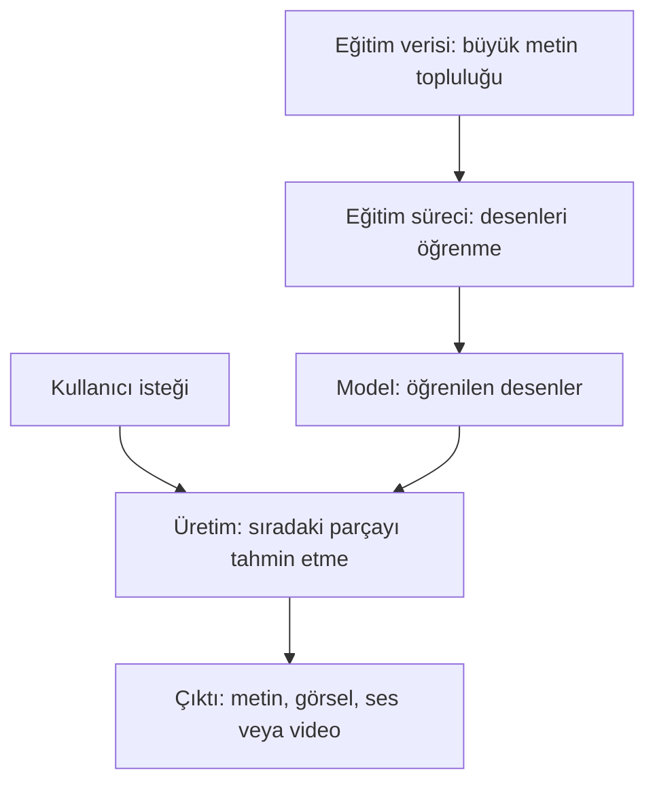
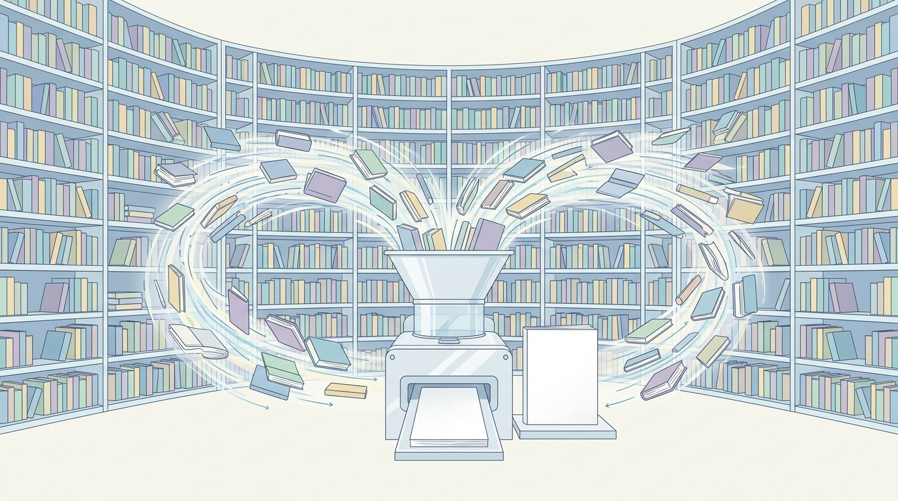

# Üretken Yapay Zekâ Nasıl Çalışır?

## 🎯 Bu Bölümde Ne Öğreneceğiz?

- Üretken yapay zekânın üç temel bileşenini (veri, model ve eğitim) ayırt edeceksin.
- Büyük dil modelinin bir metni nasıl küçük parçalara (token) böldüğünü açıklayacaksın.
- Modelin neden olasılıksal çalıştığını ve bunun çıktıya nasıl yansıdığını gözlemleyeceksin.
- Bir modelin hazır bir veritabanından arama yapmadığını örneklerle açıklayacaksın.

## 💡 Neden Bu Konuyu Öğreniyoruz?

Bir sohbet aracı, sorunu yanıtladığında bazen "sanki gerçekten biliyor" izlenimi verir. Bu izlenim güçlüdür; insanı yanıltabilir. Aracın nasıl çalıştığını bilirsen, ne zaman güvenebileceğini, ne zaman şüphelenmen gerektiğini ve çıktıyı nasıl daha iyi yönlendirebileceğini anlarsın. Bu bölüm, "sihir" gibi görünen şeyi anlaşılır bir sürece çevirir.

## Ön Bilgi

Bölüm 1'de üretken yapay zekânın **yeni içerik ürettiğini** ve geleneksel yapay zekâdan bu yönüyle ayrıldığını öğrendin. Bu bölümde "yeni içerik" ifadesinin arkasındaki sürece bakacağız.

## Temel Kavramlar

Üretken yapay zekâyı üç bileşenle düşünebilirsin: **veri**, **model** ve **eğitim süreci**.

- **Eğitim verisi (training data):** Modele örnek olarak gösterilen büyük metin, görüntü veya ses topluluğudur.
- **Eğitim süreci (training):** Modelin bu örneklerdeki desenleri öğrendiği aşamadır.
- **Model:** Eğitim sonucunda ortaya çıkan ve yeni içerik üretebilen yapıdır.

Bu bileşenlerin nasıl birbirine bağlandığını diyagramdan izleyebilirsin:

**Büyük dil modeli (large language model)**, büyük miktarda metin üzerinde eğitilmiş ve metin üretmeye odaklanmış üretken bir modeldir. Sohbet araçlarının çoğu büyük dil modellerine dayanır.

Peki model, bir metni nasıl işler? Model, metni tek seferde bütün olarak almaz. Metni **token** adı verilen küçük parçalara böler. Bir token bazen bir kelime, bazen bir kelimenin parçası, bazen bir noktalama işaretidir. Aşağıdaki tablo yalnızca **gösterim amaçlıdır**; gerçek araçların böldüğü parçalar araçtan araca değişir.

| Örnek cümle | Gösterim amaçlı token'lar |
|---|---|
| "Diş hekimliği zor ama güzeldir." | Diş · hekimliği · zor · ama · güzel · dir · . |

Modelin asıl işi şudur: **verilen parçalardan yola çıkarak sıradaki parçayı tahmin etmek.** Bu tahmin rastgele değildir; model, eğitim sırasında öğrendiği desenlere göre bir **olasılık dağılımı** oluşturur ve en uygun parçayı seçer. Aşağıdaki tablo, "Bu sabah hava çok ___" cümlesindeki boşluk için örnek bir dağılımı gösterir:

| Sıradaki kelime | Örnek olasılık |
|---|---|
| güzel | %45 |
| soğuk | %30 |
| yağmurlu | %15 |
| başka | %10 |

Bu dağılım **olasılıksal** olduğu için model, aynı isteğe her seferinde tıpatıp aynı yanıtı vermeyebilir. Küçük bir fark, çıktının yönünü değiştirebilir. İlerleyen bölümlerde bu özelliği kendi yararına nasıl kullanacağını göreceksin.

> [!IMPORTANT]
> Model, hazır bir veritabanından doğru cevabı "bulup getirmez". Öğrendiği desenlere dayanarak ikna edici bir içerik **üretir**. Bu yüzden ürettiği bilgi, doğru olmak zorunda değildir. Bu konuyu Bölüm 3'te ayrıntılı işleyeceğiz.

## 🔍 Birlikte Keşfedelim

Bu keşifte, modelin olasılıksal yapısını kendi gözünle göreceksin.

1. Ücretsiz bir sohbet aracına şu istemi ver: "Bana tek cümleyle, kahvaltıda yumurtanın faydasını anlat."
2. Aynı istemi üç kez daha gönder.
3. **Tahminin:** Dört yanıt birebir aynı mı olur, yoksa aralarında farklar mı olur? Cevabını yaz.
4. Şimdi dene ve dört yanıtı yan yana koy.
5. **Ne gözlemledin?** Yanıtlar genellikle birbirine benzer, ama çoğu zaman birebir aynı değildir.

**Açıklama:** Model her adımda sıradaki token'ı bir olasılık dağılımından seçer. Bu seçim her zaman tek bir seçeneğe kilitli olmadığı için aynı istek farklı biçimlerde karşılanabilir. Gördüğün bu küçük çeşitlilik, modelin olasılıksal doğasının doğrudan sonucudur.

## 🛠️ Uygulama

Şimdi modelin "sıradaki parçayı tahmin etme" işini daha yakından göreceksin.

1. Sohbet aracına şu istemi ver: "Şu cümleyi tamamla ve yalnızca tamamlanmış cümleyi yaz: 'Sabah dişlerimi fırçalamayı unutunca...'"
2. Gelen tamamlamayı not et.
3. Aynı istemi tekrar gönder ve yeni tamamlamayı not et.
4. İki tamamlamayı karşılaştır: Kelimeler değişti mi? Anlam aynı kaldı mı?

Burada dikkat etmen gereken nokta şu: Araç, cümlenin devamı için "doğru" bir cevap aramadı; öğrendiği desenlere göre **makul bir devam üretti**. Farklı bir devam da pekâlâ makul olabilirdi.

## 🧪 Deneyelim ve Gözlemleyelim

Bu deneyde tek bir kelimeyi değiştirip çıktının nasıl değiştiğini gözlemleyeceksin.

1. Şu istemi ver: "İki cümleyle, diş ağrısının neden erken tedavi edilmesi gerektiğini anlat."
2. Yanıtı not et.
3. Şimdi yalnızca sonuna şu ifadeyi ekle: "Bir çocuğa anlatır gibi yaz."
4. Yeni yanıtı öncekiyle karşılaştır.

**Tahmin ve gözlem:** İsteğe eklediğin tek bir ifade, üslubu ve kelime seçimini belirgin biçimde değiştirdi mi? Değiştirdiyse, modelin çıktısının girdiye ne kadar duyarlı olduğunu görmüş oldun. İlerleyen bölümlerde bu duyarlılığı bilinçli olarak yönlendirmeyi öğreneceksin.

## ✍️ Kendin Dene

Aşağıdaki cümleyi ele al: **"Kütüphanede sessizce oturup..."**

1. Önce sen, insan olarak, cümleyi zihninde tamamla. Sence devamı ne olur? Yaz.
2. Sonra aynı cümleyi bir sohbet aracına verip tamamlamasını iste.
3. İki tamamlamayı karşılaştır.

İpucu

Kendine şu soruyu sor: Senin tamamlaman, geçmiş deneyimlerine mi dayanıyor? Modelin tamamlaması ise eğitim sırasında gördüğü metinlerdeki desenlere dayanır. İkisi birbirine benzeyebilir; çünkü ikisi de "sık görülen devamları" üretmeye çalışır.

Ortak yön: İkisinde de en olası görünen devam seçiliyor.
Farklı yön: Senin seçimin bilinçli bir niyet taşır; modelin seçimi yalnızca desen ve olasılığa dayanır.

Çözüm

Kesin bir "doğru" cevap yoktur. Beklenen çıkarım şudur: Model, tıpkı senin gibi o cümle için **makul** bir devam üretir; ama bunu anlayarak değil, öğrendiği olasılıklara göre yapar. Bu yüzden modelin çıktısı dilbilgisi açısından kusursuz görünse bile gerçek dünyada yanlış olabilir.

## ❓ Öğrendiklerini Kontrol Et

1. Üretken yapay zekânın üç temel bileşenini yaz.
2. "Token" nedir? Kısaca açıkla.
3. Model neden aynı isteğe her zaman tıpatıp aynı yanıtı vermez?
4. Bir sohbet aracı, bir bilgiyi "veritabanından bulup getirir mi"? Neden?

Cevapları göster

1. **Veri** (eğitim verisi), **model** ve **eğitim süreci**.
2. Metnin, modelin işlediği küçük parçalara bölünmüş biçimidir. Bir token bir kelime, bir kelime parçası veya bir noktalama işareti olabilir.
3. Çünkü model sıradaki parçayı bir **olasılık dağılımından** seçer. Bu seçim her zaman tek bir seçeneğe kilitli olmadığı için çıktıda küçük farklar oluşabilir.
4. Hayır. Model, hazır bir yerden cevap getirmez; öğrendiği **desenlere** dayanarak ikna edici bir içerik üretir. Bu yüzden ürettiği bilgi doğru olmak zorunda değildir.

## 🧭 Daha Fazlasını Öğrenmek

- Aracın kendi **yardım merkezinde**, modelin sürümü ve güncellenme tarihiyle ilgili bilgiler bulunabilir. Ayrıntılar zamanla değiştiği için en güncel bilgi aracın resmî sayfalarındadır.
- Bir sonraki bölümde modelin **nerede ve neden yanıldığına** bakacağız. İstersen Bölüm 3'e geçmeden önce "halüsinasyon" ve "bağlam penceresi" ifadelerini kısaca araştırabilirsin.

## 📌 Kısa Özet

- Üretken yapay zekâ üç bileşenle anlaşılır: eğitim verisi, model ve eğitim süreci.
- Büyük dil modeli, metni token adı verilen küçük parçalara böler.
- Model, sıradaki token'ı olasılıklara göre tahmin eder; bu yüzden çıktı olasılıksaldır.
- Model, hazır bir kaynaktan cevap getirmez; desenlere dayanarak içerik üretir.
- Bu nedenle modelin ürettiği bilgi her zaman doğru değildir.

---
[Önceki Bölüm](01-Generative-Basics.md) | [Kurs Ana Sayfası](../README.md) | [Sonraki Bölüm](03-Limits-And-Verification.md)
