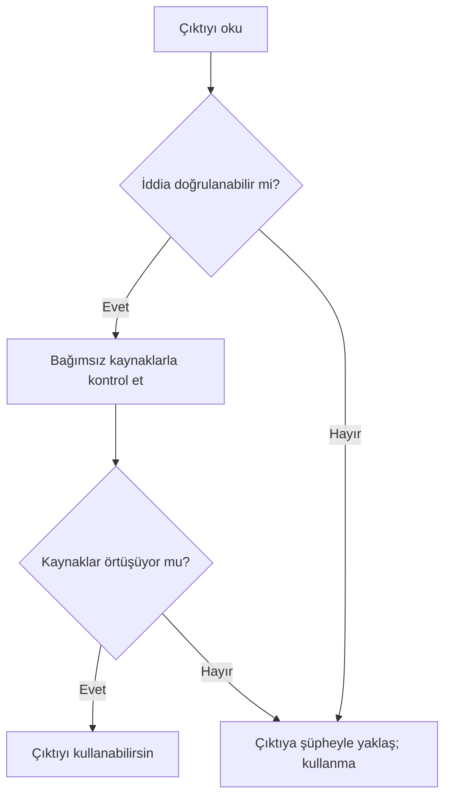

# Halüsinasyon, Sınırlar ve Doğrulama

## 🎯 Bu Bölümde Ne Öğreneceğiz?

- Halüsinasyonun (hallucination) ne olduğunu ve neden ortaya çıktığını açıklayacaksın.
- "Bilgi kesim tarihi" ve "bağlam penceresi" kavramlarının ne anlama geldiğini açıklayacaksın.
- Bir yapay zekâ çıktısını bağımsız kaynaklarla doğrulayacaksın.
- Güvenilir ve güvenilmez çıktıları ayırt edeceksin.

## 💡 Neden Bu Konuyu Öğreniyoruz?

Üretken yapay zekâ çıktılarını çok emin bir tonda sunar. Bu güvenli ton, insanı kolayca yanıltır; çünkü insanlar doğal olarak emin konuşan kişiye güvenir. Oysa emin bir ton, doğru bir bilgi anlamına gelmez. Sağlık gibi alanlarda yanlış bilgi ciddi sonuçlar doğurabilir. Bu yüzden bu bölümde, çıktının nerede yanılabileceğini ve onu nasıl kontrol edeceğini öğreneceksin.

## Ön Bilgi

Bölüm 2'de modelin olasılıksal çalıştığını ve hazır bir veritabanından cevap getirmediğini öğrendin. Bu bölüm, tam o noktadan devam ediyor: Peki bu özellik, pratikte ne gibi hatalara yol açar?

## Temel Kavramlar

**Halüsinasyon (hallucination)**, modelin yanlış ya da tamamen uydurma bir bilgiyi, kendinden emin bir biçimde doğruymuş gibi sunmasıdır. Model, yalan söylemeye çalışmaz; çünkü ne doğruyu ne yalanı bilir. Yalnızca, kendisine makul görünen bir içerik üretir. Bazen bu içerik bir yazar adı, bir kitap başlığı, bir tarih ya da bir sayı gibi gerçek görünen ama var olmayan bir ayrıntı olur.

Halüsinasyonun birkaç yaygın nedeni vardır:

- **Model doğruluk kontrolü yapmaz.** Amacı "doğru olmak" değil, "makul görünen sıradaki parçayı üretmek"tir.
- **Bilgi kesim tarihi (knowledge cutoff):** Modelin eğitim verisi belirli bir tarihte sona erer. Bu tarihten sonraki olayları bilemez.
- **Bağlam penceresi (context window):** Modelin aynı anda aklında tutabileceği metin miktarı sınırlıdır. Çok uzun bir sohbette, baştaki ayrıntılar gözden kaybolabilir.
- **Belirsiz sorular:** Çok genel ya da çok ayrıntılı sorularda model, boşluk bırakmak yerine makul bir tahmin üretmeyi "tercih" edebilir.

Doğrulamayı bir alışkanlık haline getirmek için şu akışı izleyebilirsin:

> [!WARNING]
> Bir sağlık bilgisini, bir doz bilgisini ya da bir hasta kararını yalnızca bir yapay zekâ çıktısına dayanarak kullanma. Böyle durumlarda bilgiyi her zaman güvenilir bir kaynaktan (ders kitabı, akademik yayın, alan uzmanı) doğrula.

## 🔍 Birlikte Keşfedelim

Bu keşifte, bir çıktının doğrulanmadan güvenilip güvenilemeyeceğini göreceksin.

1. Bir sohbet aracına şu istemi ver: "Diş sağlığıyla ilgili bir bilimsel makale adı ve o makalenin yazarını yaz."
2. Gelen cevabı, verilen adı ve yazarı not et.
3. **Tahminin:** Bu makale ve yazar gerçekten var mıdır? Cevabını yaz.
4. Şimdi makale adını ve yazarı bağımsız bir kaynakta (örneğin bir akademik arama motorunda) ara.
5. **Ne gözlemledin?** Cevap bazen gerçek bir kaynağa denk gelir; ancak bazen hiç var olmayan bir makale "uydurulmuş" olabilir.

**Açıklama:** Model, gerçek bir kaynağı hatırlamak zorunda değildir. Bir makale adı gibi görünen bir metni, tıpkı diğer metinleri ürettiği gibi üretebilir. Bu yüzden kaynak göstermek, tek başına doğruluk kanıtı değildir. Kaynağın gerçekten var olup olmadığını ayrıca kontrol etmelisin.

## 🛠️ Uygulama

Şimdi doğrulama alışkanlığını somut bir örnekte deneyelim.

1. Sohbet aracına oldukça ayrıntılı, doğrulanabilir bir soru sor. Örneğin: "2015 yılında Türkiye'de diş hekimliği eğitimi veren fakültelerin sayısı kaçtı?"
2. Gelen cevabı ve varsa verdiği kaynağı not et.
3. Cevabı, güncel ve güvenilir bir kaynaktan kontrol et (örneğin resmî kurum sayfaları ya da güncel bir kaynak).
4. Çıktı ile gerçek bilgi örtüşüyor mu?

Bu uygulamada önemli olan, cevabın doğru çıkması değil; **doğrulama adımını alışkanlık haline getirmendir**. Aracın verdiği emin ton seni yanıltmasın.

## 🧪 Deneyelim ve Gözlemleyelim

Bu deneyde, modelin bilgi kesim tarihini hissetmeye çalışacaksın.

1. Sohbet aracına, çok eski bir olayla ilgili bir soru sor (örneğin yıllar önce gerçekleşmiş bir olay).
2. Ardından, çok yakın bir tarihte gerçekleşmiş bir olayla ilgili bir soru sor.
3. İki yanıtı karşılaştır.

**Tahmin ve gözlem:** Yakın tarihli olayla ilgili yanıt, daha belirsiz ya da yanlış olabilir. Çünkü modelin bilgisi eğitim verisinin bittiği tarihe kadar uzanır; sonrası için elinde öğrenilmiş bir bilgi yoktur. Yine de model, "bilmiyorum" demek yerine makul bir cevap üretebilir. İşte bu, halüsinasyonun tipik görünümüdür.

## 🧰 Bir Şeyler Ters Giderse

Bir çıktının uydurma olup olmadığını anlamak için şu kontrol listesini kullan:

- **Kaynak gerçekten var mı?** Verilen kaynağı bağımsız olarak ara. Bulamıyorsan, çıktıya güvenme.
- **Sayılar tutarlı mı?** Aynı soruyu farklı biçimde sor ve yanıtları karşılaştır. Sayılar değişiyorsa şüphelen.
- **Bildiğin bir bilgiyle çelişiyor mu?** Zaten emin olduğun bir bilgiyle çelişiyorsa, çıktıyı yeniden değerlendir.
- **Çok mu kesin konuşuyor?** Aşırı emin ton, doğruluk kanıtı değildir. Özellikle ayrıntılı iddiaları kontrol et.

Bu adımlar, çıktıyı çöpe atmak için değil, onu **ne zaman kullanabileceğine** karar vermek içindir.

## ✍️ Kendin Dene

Bir sohbet aracına, doğrulanabilir bir bilgi içeren bir soru sor. Örneğin: "Dünya Sağlık Örgütü hangi yıl kuruldu?"

1. Aracın cevabını not et.
2. Cevabı, **iki bağımsız kaynaktan** doğrula.
3. Sonucu bir cümleyle yaz: Çıktı doğru muydu, yanlış mıydı, yoksa kısmen mi doğruydu?

İpucu

Bağımsız kaynak, cevabı yapay zekâdan almayan kaynaktır. Örneğin bir kurumun resmî sayfası ya da güvenilir bir ansiklopedi. İki kaynağın aynı bilgiyi vermesi, güvenini artırır.

Çözüm

Bu görevin amacı tek bir "doğru cevabı" ezberlemek değil, **doğrulama sürecini** yaşamaktır. Beklenen davranış: Cevabı aldıktan sonra hiç düşünmeden kabul etmek yerine, iki bağımsız kaynağa bakmak ve sonucu karşılaştırmak. Eğer kaynaklar hem kendi aralarında hem de çıktıyla örtüşüyorsa çıktıyı kullanabilirsin. Örtüşmüyorsa, şüpheni koruyup bilgiyi güvenilir kaynaktan yeniden almalısın.

## ❓ Öğrendiklerini Kontrol Et

1. Halüsinasyon nedir? Kısaca tanımla.
2. "Bilgi kesim tarihi" ne demektir ve neden önemlidir?
3. "Bağlam penceresi" sınırlı olduğunda ne tür sorunlar çıkabilir?
4. Bir yapay zekâ çıktısı kaynak gösteriyorsa, bu kaynak neden doğruluk kanıtı değildir?

Cevapları göster

1. Modelin yanlış ya da uydurma bir bilgiyi, kendinden emin bir biçimde doğruymuş gibi sunmasıdır.
2. Modelin eğitim verisinin bittiği tarihtir. Bu tarihten sonraki olaylar hakkında modelin öğrenilmiş bilgisi yoktur; yine de cevap üretmeye çalışabilir.
3. Uzun bir sohbette baştaki ayrıntılar modelin "aklından çıkabilir"; bu da tutarsız ya da bağlamdan kopuk yanıtlara yol açabilir.
4. Çünkü model kaynağı da tıpkı diğer metinleri ürettiği gibi üretebilir. Gösterilen kaynağın gerçekten var olup olmadığını ayrıca kontrol etmek gerekir.

## 🧭 Daha Fazlasını Öğrenmek

- Kullandığın aracın resmî **yardım merkezinde**, modelin güncel sürümü ve bilgi kesim tarihiyle ilgili açıklamalar bulunabilir. Bu bilgiler sık değiştiği için aracın kendi sayfalarına bakmak en doğrusudur.
- Bir sonraki bölümde, metin ve sohbet araçlarını kullanarak özetleme ve taslak oluşturma gibi görevleri öğreneceğiz.

## 📌 Kısa Özet

- Halüsinasyon, modelin uydurma bilgiyi emin bir tonda sunmasıdır.
- Model doğruluk kontrolü yapmaz; bilgi kesim tarihi ve bağlam penceresi gibi sınırları vardır.
- Kaynak göstermek tek başına doğruluk kanıtı değildir.
- Her önemli çıktıyı bağımsız kaynaklarla doğrulamak gerekir.
- Emin ton, doğru bilgi anlamına gelmez.

---
[Önceki Bölüm](02-Models-And-Training.md) | [Kurs Ana Sayfası](../README.md) | [Sonraki Bölüm](04-Chat-Text-Tools.md)
