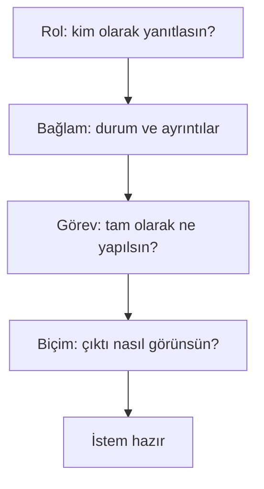

# Etkili İstem (Prompt) Yazma

## 🎯 Bu Bölümde Ne Öğreneceğiz?

- İstem (prompt) kavramını tanımlayacaksın.
- Rol, bağlam, görev ve biçim bileşenlerini kullanarak istem yazacaksın.
- Zayıf bir istemi güçlü bir isteme dönüştüreceksin.
- Yaygın istem hatalarını tanıyacaksın.

## 💡 Neden Bu Konuyu Öğreniyoruz?

Bir yapay zekâ aracından aldığın sonucun kalitesi, büyük ölçüde ona verdiğin isteğe bağlıdır. Kısa ve belirsiz bir istek, genel ve işe yaramaz bir yanıt getirir. Aynı araç, iyi yazılmış bir istemle çok daha isabetli bir çıktı üretir. Bu bölüm, aracı değiştirmeden yalnızca isteğini iyileştirerek sonucu nasıl belirgin biçimde iyileştirebileceğini gösterir.

## Ön Bilgi

Bölüm 4'te sohbet ve metin araçlarını tanıdın. Bu bölümde aynı araçları, bu kez daha bilinçli bir istemle kullanacaksın.

## Temel Kavramlar

**İstem (prompt)**, bir üretken yapay zekâ aracına verdiğin istektir. Soru biçiminde olabilir; ama daha etkili istemler genellikle birkaç bileşenden oluşur:

- **Rol:** Araç, hangi bakış açısıyla yanıt versin? (Örneğin "bir diş hekimi gibi".)
- **Bağlam:** Durum ve gerekli ayrıntılar nelerdir? (Örneğin "kime, neden, hangi düzeyde anlatılacak".)
- **Görev:** Tam olarak ne yapılması isteniyor? (Örneğin "üç madde yaz".)
- **Biçim:** Çıktı nasıl görünsün? (Örneğin "madde madde, en fazla on kelime".)

Bu bileşenleri şu sırayla düşünebilirsin:

Bu dört bileşeni bir arada görelim:

| Bileşen | Sorduğu soru | Örnek ifade |
|---|---|---|
| Rol | Kim olarak? | "Bir diş hekimi gibi yanıtla." |
| Bağlam | Hangi durumda? | "Konuyu hiç bilmeyen bir hastaya anlatıyorum." |
| Görev | Ne yapılsın? | "Fırçalamanın önemini açıkla." |
| Biçim | Nasıl sunulsun? | "Üç madde hâlinde, her madde bir cümle." |

Zayıf ve güçlü bir istemi karşılaştıralım:

| Zayıf istem | Güçlü istem |
|---|---|
| "Diş hakkında bir şey yaz." | "Bir diş hekimi gibi yanıtla. Konuyu hiç bilmeyen bir hastaya, günde iki kez fırçalamanın önemini üç maddede anlat; her madde bir cümle olsun." |

Yaygın istem hataları şunlardır:

- **Belirsiz görev:** "Bana yardım et." Ne konuda, nasıl bir yardım?
- **Bağlam eksikliği:** Kime, hangi düzeyde anlatıldığı belirtilmez.
- **Biçim verilmemesi:** Uzunluk ve düzen belirtilmez; araç kararı kendisi verir.
- **Birden fazla işi tek istekte istemek:** Görevler ayrı ayrı istenirse sonuç daha nettir.

## 🔍 Birlikte Keşfedelim

Bu keşifte, istemi iyileştirmenin çıktıyı nasıl değiştirdiğini göreceksin.

1. Bir sohbet aracına şu zayıf istemi ver: "Diş fırçalama hakkında bir şeyler yaz."
2. Yanıtı not et.
3. **Tahminin:** İsteme rol, bağlam, görev ve biçim eklersem yanıt nasıl değişir? Yaz.
4. Şimdi aynı araca şu güçlü istemi ver: "Bir diş hekimi gibi yanıtla. Konuyu hiç bilmeyen bir kişiye, sabah ve akşam fırçalamanın önemini üç maddede anlat; her madde en fazla bir cümle olsun."
5. İki yanıtı karşılaştır.

**Ne gözlemledin?** Güçlü istemin yanıtı daha düzenli, daha odaklı ve daha kısa oldu mu? Fark, aracın değil, **isteğinin** kalitesinden geldi.

## 🛠️ Uygulama

Şimdi bir istemi adım adım inşa edeceksin.

1. Elindeki zayıf istemle başla: "Sağlıklı beslenme hakkında yaz."
2. Yanıtı al ve not et.
3. İsteme yalnızca **rol** ekle: "Bir beslenme uzmanı gibi yanıtla. Sağlıklı beslenme hakkında yaz." Yanıt nasıl değişti?
4. Şimdi **bağlam** ekle: "...üniversite öğrencisi bir arkadaşıma anlatıyorum." Yanıt nasıl değişti?
5. Şimdi **görev** ekle: "...üç temel öneri ver." Yanıt nasıl değişti?
6. Son olarak **biçim** ekle: "...her öneri bir cümle olsun." Yanıt nasıl değişti?

Her adımda yanıtın biraz daha isabetli olduğunu göreceksin. Bu, istem yazımının en önemli fikridir: Sonuç, isteğinin niteliğiyle birlikte iyileşir.

## 🧪 Deneyelim ve Gözlemleyelim

Bu deneyde yalnızca **biçim** bileşeninin etkisini ölçeceksin.

1. Şu istemi ver: "Kahvaltının önemini anlat."
2. Ardından aynı isteği şu biçimle ver: "Kahvaltının önemini, tam olarak üç madde hâlinde ve her madde en fazla sekiz kelime olacak şekilde anlat."
3. İki yanıtı karşılaştır.

**Tahmin ve gözlem:** Biçim verildiğinde yanıt, belirttiğin yapıya uydu mu? Uymadıysa, biçimi biraz daha netleştirerek tekrar dene. Biçim bileşeni, çıktıyı beklediğin kalıba sokmanın en doğrudan yoludur.

## ✍️ Kendin Dene

Aşağıdaki zayıf istemi, dört bileşeni de (rol, bağlam, görev, biçim) içeren güçlü bir isteme dönüştür:

> "Bana diş sağlığı hakkında bilgi ver."

Sonra bu güçlü istemi bir sohbet aracında dene ve çıktıyı değerlendir.

İpucu

Her bileşen için kendine bir soru sor: Kim olarak (rol)? Hangi durumda (bağlam)? Tam olarak ne (görev)? Nasıl sunulsun (biçim)? Dördünü birleştirip tek bir istem yaz.

Çözüm

Örnek bir güçlü istem şöyle olabilir: "Bir diş hekimi gibi yanıtla. Diş hekimliği birinci sınıf öğrencisi bir arkadaşıma anlatıyorum. Günlük diş bakımında dikkat edilmesi gereken üç temel noktayı yaz; her nokta iki cümleyi geçmesin."

Bu istem dört bileşeni de içerir: rol (diş hekimi), bağlam (arkadaş, birinci sınıf), görev (üç temel nokta), biçim (her nokta en fazla iki cümle). Senin istemin farklı olabilir; önemli olan dört bileşenin de bulunmasıdır.

## ❓ Öğrendiklerini Kontrol Et

1. İstem (prompt) nedir?
2. Etkili bir istemin dört bileşenini yaz.
3. "Bana yardım et." istemi neden zayıftır?
4. Aynı araç, aynı görevde nasıl daha iyi bir sonuç verebilir; tek bir değişiklikle açıkla.

Cevapları göster

1. Bir üretken yapay zekâ aracına verdiğin istektir.
2. Rol, bağlam, görev ve biçim.
3. Çünkü görev belirsizdir: Ne konuda, nasıl bir yardım istendiği belli değildir. Araç, kendi tahminine göre genel bir yanıt üretir.
4. İstemi iyileştirerek. Rol, bağlam, görev ve biçim bileşenlerini eklemek, aracı değiştirmeden çıktının kalitesini artırır.

## 🧭 Daha Fazlasını Öğrenmek

- Bazı araçların resmî **yardım merkezlerinde** istem yazımıyla ilgili rehberler bulunur. Bunlar genel ilkeler sunar; ancak özgün istemini kendin yazman gerekir.
- Bir sonraki bölümde, tek seferlik istemin ötesine geçip istemi **yineleyerek iyileştirmeyi** ve ileri teknikleri öğreneceğiz.

## 📌 Kısa Özet

- İstem, araca verdiğin istektir; sonucun kalitesi büyük ölçüde ona bağlıdır.
- Etkili bir istem dört bileşenden oluşur: rol, bağlam, görev, biçim.
- Belirsiz istem genel yanıt getirir; belirli istem odaklı yanıt getirir.
- Aracı değiştirmeden yalnızca istemi iyileştirerek çıktı kalitesini artırabilirsin.
- Birden fazla işi tek istekte istemek yerine görevleri ayır.

---
[Önceki Bölüm](04-Chat-Text-Tools.md) | [Kurs Ana Sayfası](../README.md) | [Sonraki Bölüm](06-Advanced-Prompting.md)
