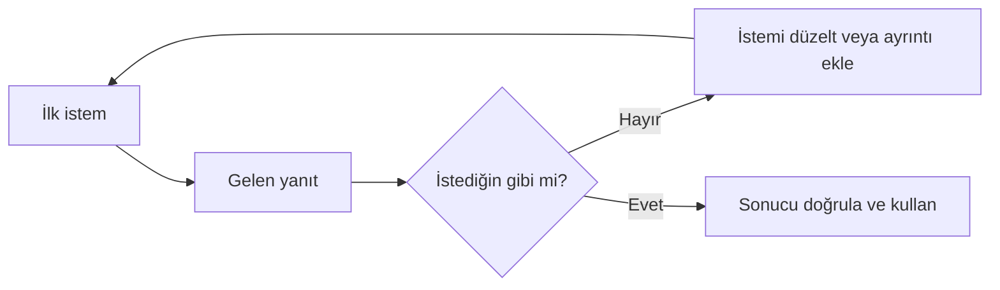

# İstem Yineleme ve İleri Teknikler

## 🎯 Bu Bölümde Ne Öğreneceğiz?

- Bir istemi yineleyerek (iteration) adım adım iyileştireceksin.
- Örnek vererek yönlendirme (few-shot) tekniğini kullanacaksın.
- Modeli ara adımları göstermeye yönlendireceksin.
- Modelden, emin olmadığında bunu belirtmesini isteyeceksin.

## 💡 Neden Bu Konuyu Öğreniyoruz?

İyi bir istem genellikle ilk denemede ortaya çıkmaz. Tıpkı bir metni yazarken düzeltmeler yaptığın gibi, istemi de birkaç turda geliştirirsin. Bu bölüm, tek seferlik istemin ötesine geçerek sonucu adım adım iyileştirmeyi ve daha karmaşık görevlerde kullanılan birkaç pratik tekniği öğretir.

## Ön Bilgi

Bölüm 5'te istemin dört bileşenini (rol, bağlam, görev, biçim) öğrendin. Bu bölüm, bu temelin üzerine kurulur.

## Temel Kavramlar

**Yineleme (iteration)**, istemi tek seferde bitirmek yerine, gelen yanıtı gözden geçirip istemi düzeltip yeniden deneme döngüsüdür. Şu akışı izler:

Sık kullanılan ileri teknikler şunlardır:

- **Örnek vererek yönlendirme (few-shot):** İstemin içine bir veya birkaç örnek koyarsın. Model, örnekteki kalıbı izlemeye çalışır.
- **Adım adım düşünmeye yönlendirme:** Karmaşık bir görevde modelden ara adımları göstermesini istersin. Bu, sonucun izlenebilir olmasını sağlar.
- **Belirsizlik itirafı:** İsteme "emin değilsen açıkça söyle" gibi bir cümle eklersin. Bu, uydurma bir kesinliği azaltmaya yardımcı olur. (Bölüm 3'teki halüsinasyon konusunu hatırla.)

> [!NOTE]
> "Adım adım düşünmeye yönlendirme" ifadesi, modelin gerçekten düşündüğü anlamına gelmez. Bölüm 2'de gördüğün gibi model, ara adımları da bir metin olarak üretir. Yine de bu yöntem, karmaşık görevlerde çıktının daha düzenli olmasına yardımcı olur.

## 🔍 Birlikte Keşfedelim

Bu keşifte, yinelemenin gücünü göreceksin.

1. Bir sohbet aracına şu istemi ver: "Sınav stresi için kısa bir tavsiye yaz."
2. Yanıtı not et.
3. **Tahminin:** İsteme "bir diş hekimliği öğrencisine göre" ve "üç madde hâlinde" eklersem yanıt nasıl değişir? Yaz.
4. İstemi şöyle güncelle: "Bir üniversite danışmanı gibi yanıtla. Diş hekimliği birinci sınıf öğrencisi bir arkadaşıma, sınav stresiyle baş etmek için üç madde hâlinde tavsiye yaz."
5. Yeni yanıtı öncekiyle karşılaştır.

**Ne gözlemledin?** İkinci istem daha kişisel ve daha düzenli bir yanıt üretti. İstemi tamamen yeniden yazmadın; yalnızca gözlemine dayanarak düzelttin. İşte yineleme budur.

## 🛠️ Uygulama

Şimdi örnek vererek yönlendirmeyi (few-shot) deneyeceksin.

1. Bir sohbet aracına şu istemi ver: "Aşağıdaki soruları aynı üslupla yanıtla. Örnek soru: 'Diş eti kanaması neden olur?' Örnek yanıt: 'Diş eti kanaması çoğu zaman plak birikimiyle ilişkilidir.' Şimdi şu soruyu aynı üslupla yanıtla: 'Ağız kokusu neden olur?'"
2. Gelen yanıtı incele: Örnekteki üsluba benziyor mu?
3. Şimdi aynı soruyu örnek vermeden sor ve iki yanıtı karşılaştır.

Bu uygulamada gördüğün şu: Verdiğin örnek, modelin üslubu yakalamasına yardımcı olur. Örnek ne kadar netse, çıktı da o kalıba o kadar yaklaşır.

## 🧪 Deneyelim ve Gözlemleyelim

Bu deneyde, adım adım yönlendirmenin etkisini ölçeceksin.

1. Şu istemi ver: "Bir öğrenci günde iki kez dişini fırçalıyor. Yılda kaç kez fırçalamış olur? Sonucu yaz."
2. Ardından şu istemi ver: "Bir öğrenci günde iki kez dişini fırçalıyor. Yılda kaç kez fırçalamış olur? Adımları tek tek göster, sonra sonucu yaz."
3. İki yanıtı karşılaştır.

**Tahmin ve gözlem:** Adımları gösterdiğinde yanıt daha izlenebilir oldu mu? Bir sonucu yalnızca sayı olarak görmek yerine, nasıl elde edildiğini görebildin mi? Bu yöntem, özellikle çok adımlı görevlerde hatayı fark etmeni kolaylaştırır.

## ✍️ Kendin Dene

Aşağıdaki ilk istemi en az iki turda iyileştir:

> İlk istem: "Bana ağız bakımıyla ilgili ipuçları ver."

1. Bu istemi çalıştır ve çıktıyı not et.
2. Çıktıda bir eksik gör ve istemi buna göre düzelt (örneğin bağlam, görev veya biçim ekle).
3. Bir tur daha düzelt.
4. Son istemini ve son çıktıyı, ilk çıktıyla karşılaştır.

İpucu

Her turda yalnızca **bir** bileşene odaklan. Örneğin ilk turda bağlamı ekle ("kim için"), ikinci turda biçimi ekle ("kaç madde"). Böylece her değişikliğin etkisini net görürsün.

Çözüm

Kesin bir doğru istem yoktur. Beklenen süreç şudur: İlk genel istemden yola çıkıp, gelen yanıtı değerlendirerek bağlam, görev ve biçim gibi bileşenler eklemek ve her turda çıktının nasıl değiştiğini gözlemlemek. Örnek bir son istem: "Bir diş hekimi gibi yanıtla. Üniversite öğrencisi bir arkadaşıma, günlük ağız bakımı için üç pratik ipucu yaz; her ipucu iki cümleyi geçmesin."

## ❓ Öğrendiklerini Kontrol Et

1. Yineleme (iteration) nedir? Kısaca açıkla.
2. Örnek vererek yönlendirme (few-shot) nasıl çalışır?
3. "Adım adım düşünmeye yönlendirme", modelin gerçekten düşündüğü anlamına gelir mi? Neden?
4. İsteme "emin değilsen söyle" cümlesini eklemek hangi sorunu azaltmaya yardımcı olur?

Cevapları göster

1. İstemi tek seferde bitirmek yerine, gelen yanıtı gözden geçirip istemi düzelt ve yeniden dene döngüsüdür.
2. İstemin içine bir veya birkaç örnek konur; model, bu örnekteki kalıbı izlemeye çalışır.
3. Anlamına gelmez. Model, ara adımları da birer metin olarak üretir. Yine de bu yöntem, çıktıyı daha düzenli ve izlenebilir kılar.
4. Halüsinasyonu, yani modelin emin bir tonda uydurma bilgi sunmasını azaltmaya yardımcı olur.

## 🧭 Daha Fazlasını Öğrenmek

- Kullandığın araçların resmî **yardım merkezlerinde** istem teknikleriyle ilgili rehberler bulunabilir. Bunlar genel çerçeve sunar; asıl gelişme, teknikleri kendi görevlerinde deneyerek olur.
- Bir sonraki bölümde istem becerini **görsel üretime** taşıyacağız.

## 📌 Kısa Özet

- İyi istem genellikle birkaç turda ortaya çıkar; yineleme normaldir.
- Örnek vererek yönlendirme, çıktının üslubunu yakalamaya yardımcı olur.
- Adım adım yönlendirme, çıktıyı izlenebilir kılar ama modelin "düşündüğü" anlamına gelmez.
- Modelden emin olmadığında bunu belirtmesini istemek, uydurma kesinliği azaltır.
- Her turda tek bir bileşene odaklanmak, değişikliğin etkisini net gösterir.

---
[Önceki Bölüm](05-Prompt-Writing.md) | [Kurs Ana Sayfası](../README.md) | [Sonraki Bölüm](07-Image-Generation.md)
