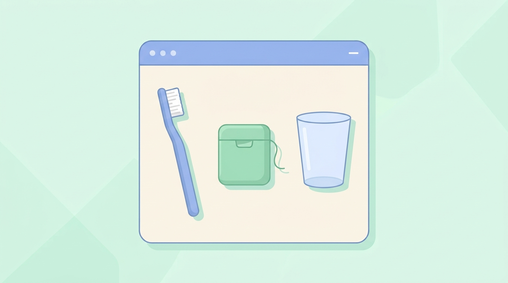

# Görsel Üretim Araçları

## 🎯 Bu Bölümde Ne Öğreneceğiz?

- Görsel üretim araçlarını tanıyacak ve birbirleriyle karşılaştıracaksın.
- Bir görsel için istem yazacaksın.
- Üretilen görseli belirli ölçütlere göre değerlendireceksin.
- İstemi değiştirerek görseli iyileştireceksin.

## 💡 Neden Bu Konuyu Öğreniyoruz?

Görsel üretim araçları, metinle tarif ettiğin bir sahneyi saniyeler içinde görsele çevirir. Sunum, poster veya ders materyali hazırlarken bu güç işine yarar. Ancak araç, senin kafandaki görüntüyü birebir okumaz; yalnızca yazdığın istemi yorumlar. Bu yüzden görselde kontrolün sende olması için istemi bilinçli yazmayı öğrenmelisin.

## Ön Bilgi

Bölüm 5 ve 6'da istem yazmayı ve istemi yineleyerek iyileştirmeyi öğrendin. Bu beceriler görsel üretimde de aynen geçerlidir.

## Temel Kavramlar

Yaygın, web tabanlı görsel üretim araçları şunlardır:

| Araç | Geliştirici | Not |
|---|---|---|
| DALL-E | OpenAI | Bazı sohbet araçlarıyla birlikte kullanılır |
| Midjourney | Midjourney | Genellikle ücretli plan gerektirir |
| Stable Diffusion | Açık kaynak topluluğu | Farklı uygulamalar üzerinden çalışır |
| Adobe Firefly | Adobe | Adobe ürünleriyle bütünleşiktir |

> [!NOTE]
> Bu araçlardan bazıları yalnızca ücretli planla tam özellik sunar. Ücretsiz bir deneme kotası ya da sınırlı ücretsiz kullanım bulunabilir. Güncel durumu aracın kendi sayfasından kontrol et.

Bir görsel istemi, metin istemine benzer ama görselin özelliklerine odaklanır. Şu bileşenleri düşünebilirsin:

| Bileşen | Sorduğu soru | Örnek |
|---|---|---|
| Konu | Ne görünecek? | "masada duran bir diş fırçası" |
| Stil | Nasıl görünecek? | "düz vektör çizim, pastel renkler" |
| Kompozisyon | Nasıl çerçevelenecek? | "yakın plan, üstten görünüm" |
| Oran | Hangi biçimde? | "yatay, 16:9" |
| Olumsuz | Ne olmasın? | "yazı olmasın" |

Üretilen bir görseli şu ölçütlerle değerlendirebilirsin:

- **Amaca uygunluk:** İstediğin sahneyi gerçekten gösteriyor mu?
- **Netlik:** Ana konu anlaşılıyor mu, yoksa karışık mı?
- **Bozulmalar:** Eller, yüzler veya metin gibi ayrıntılar bozuk mu?
- **Yazı sorunu:** Görsele eklenen metinler çoğu araçta hatalı çıkar; bu yüzden istemde "yazı olmasın" demek yararlıdır.

<details>
<summary>Örnek Türkçe İstem</summary>

```text
Açık renkli bir arka plan üzerinde düzenli bir sıra halinde dizilmiş ağız bakım ürünleri: bir diş fırçası, bir diş ipi kutusu ve bir bardak; yumuşak gölgeler, dengeli kompozisyon, boş arka plan, düz (flat) vektör çizimi, yumuşak pastel renkler; metin, harf, etiket veya filigran içermez, 16:9
```
</details>
<details>
<summary>Örnek İngilizce İstem</summary>

```text
A neat row of oral care items on a light background: a toothbrush, a dental floss box, and a glass, soft shadows, balanced composition, empty background, flat vector illustration, soft pastel colors, no text, no letters, no labels, no watermark, 16:9
```
</details> 



## 🔍 Birlikte Keşfedelim

Bu keşifte, istemin görseli nasıl belirlediğini göreceksin.

1. Ücretsiz bir görsel üretim aracı aç (ücretsiz kotası olan bir araç yeterlidir).
2. Şu zayıf istemi ver: "Bir diş çiz."
3. Gelen görseli incele.
4. **Tahminin:** İsteme stil, kompozisyon ve arka plan eklersem görsel nasıl değişir? Yaz.
5. Şimdi şu güçlü istemi ver: "Düz vektör çizim stilinde, pastel renklerle, açık arka plan üzerinde tek bir azı dişi; yakın plan ve ortalanmış; görselde yazı olmasın."
6. İki görseli karşılaştır.

**Ne gözlemledin?** Güçlü istemin görseli, istediğin stile ve düzene daha yakın oldu. Fark, aracın değil, **isteğinin ayrıntısından** geldi.

## 🛠️ Uygulama

Şimdi bir görsel istemini yineleyerek iyileştireceksin.

1. Şu istemle başla: "Ders çalışan bir öğrenci çiz."
2. Görseli al ve değerlendir: Konu anlaşılıyor mu? Bozuk bir ayrıntı var mı?
3. İsteme **stil** ekle: "...düz vektör çizim stilinde."
4. İsteme **kompozisyon** ekle: "...önündeki masada açık bir kitap; geniş açı."
5. İsteme **olumsuz** ekle: "...görselde yazı olmasın."
6. Her turda görselin nasıl değiştiğini not et.

Bu uygulamada, istemi adım adım zenginleştirdikçe görselin hedefine yaklaştığını göreceksin. Görsel üretimde de yineleme, en güçlü aracındır.

## 🧪 Deneyelim ve Gözlemleyelim

Bu deneyde yalnızca **stil** kelimesinin etkisini ölçeceksin.

1. Şu istemi ver: "Bir kalp şekli çiz."
2. Ardından aynı konuyu farklı stillerle iste: "sulu boya stilinde", "düz vektör çizim stilinde", "karakalem çizim stilinde".
3. Dört görseli yan yana koy.

**Tahmin ve gözlem:** Aynı konu, stil kelimesiyle ne kadar farklı göründü? Bu, görsel isteminde stil bileşeninin ne kadar güçlü olduğunu gösterir. İleride kendi materyallerin için bir "stil seçimi" yaparken bu bilgi işine yarayacak.

## 🧰 Bir Şeyler Ters Giderse

Görsel üretiminde sık karşılaşılan durumlar ve çözümleri:

- **Araç isteği reddediyor.** Gerçek kişileri, markaları veya telifli karakterleri istemek reddedilmeye yol açar. Konuyu genel ve özgün biçimde yeniden yaz.
- **Yazı bozuk çıkıyor.** Görsel araçları, özellikle Türkçe yazıları sıklıkla hatalı üretir. İstemde "yazı olmasın" ifadesini kullan; yazıyı ayrı bir araçla ekle.
- **Eller veya yüzler bozuk.** Konuyu sadeleştir ya da kompozisyonu değiştir (örneğin yakın plan yerine geniş açı).
- **Ücretsiz kota bitti.** Beklemeyi ya da farklı bir ücretsiz aracı denemeyi seç.

## ✍️ Kendin Dene

Bir ders konusu için **tanıtıcı bir görsel** üret. Örneğin "düzenli diş kontrolü" temasını seç.

1. Beş bileşeni de (konu, stil, kompozisyon, oran, olumsuz) içeren bir istem yaz.
2. Görseli üret.
3. Görseli dört ölçütle değerlendir: amaca uygunluk, netlik, bozulma, yazı.
4. Gerekirse istemi düzelt ve yeniden üret.

<details>
<summary>İpucu</summary>

Değerlendirirken en kritik soru şudur: "Bu görsel, dersin konusunu hiç bilmeyen birine ne anlatır?" Görsel tek başına anlaşılmıyorsa, istemi konuyu daha belirgin gösterecek biçimde düzelt.

</details>
<details>
<summary>Çözüm</summary>

Kesin bir doğru görsel veya istem yoktur. Beklenen süreç: Beş bileşeni içeren bir istem yazmak, görseli üretmek, dört ölçütle değerlendirmek ve gerekiyorsa istemi en az bir kez düzeltmek. Örnek bir istem: "Düz vektör çizim stilinde, pastel renklerle, açık arka plan üzerinde bir diş hekimi koltuğu ve yanında duran bir takvim; geniş açı; görselde yazı olmasın."

</details>

## ❓ Öğrendiklerini Kontrol Et

1. Bu bölümde adı geçen iki görsel üretim aracını yaz.
2. Bir görsel isteminin bileşenlerinden üçünü söyle.
3. Üretilen bir görseli hangi ölçütlerle değerlendirirsin?
4. Görsel araçlarında yazı neden genellikle sorun çıkarır ve bunu nasıl önlersin?

<details>
<summary>Cevapları göster</summary>

1. Örnek: DALL-E, Midjourney, Stable Diffusion, Adobe Firefly. (Herhangi ikisi yeterlidir.)
2. Örneğin: konu, stil, kompozisyon. (Oran ve olumsuz da kabul edilir.)
3. Amaca uygunluk, netlik, bozulma ve yazı sorunu.
4. Çünkü araçlar, özellikle Türkçe metinleri sıklıkla hatalı üretir. Önlemek için istemde "yazı olmasın" demek ve yazıyı ayrı bir araçla eklemek gerekir.

</details>

## 🧭 Daha Fazlasını Öğrenmek

- Kullandığın görsel aracının resmî **yardım merkezinde** istem yazımı örnekleri ve kullanım kuralları bulunabilir.
- Bir sonraki bölümde görselin ötesine geçip **ses ve video** üretim araçlarını inceleyeceğiz.

## 📌 Kısa Özet

- Görsel üretim araçları, metinle tarif edilen sahneyi görsele çevirir.
- Bir görsel istemi konu, stil, kompozisyon, oran ve olumsuz bileşenlerinden oluşur.
- Üretilen görsel, amaca uygunluk, netlik, bozulma ve yazı ölçütleriyle değerlendirilir.
- Yazı üretmek görsel araçlarında güvenilir değildir; genellikle "yazı olmasın" demek gerekir.
- Görselde de yineleme, hedefe ulaşmanın en güçlü yoludur.

---
[Önceki Bölüm](06-Advanced-Prompting.md) | [Kurs Ana Sayfası](../README.md) | [Sonraki Bölüm](08-Audio-Video-Generation.md)
