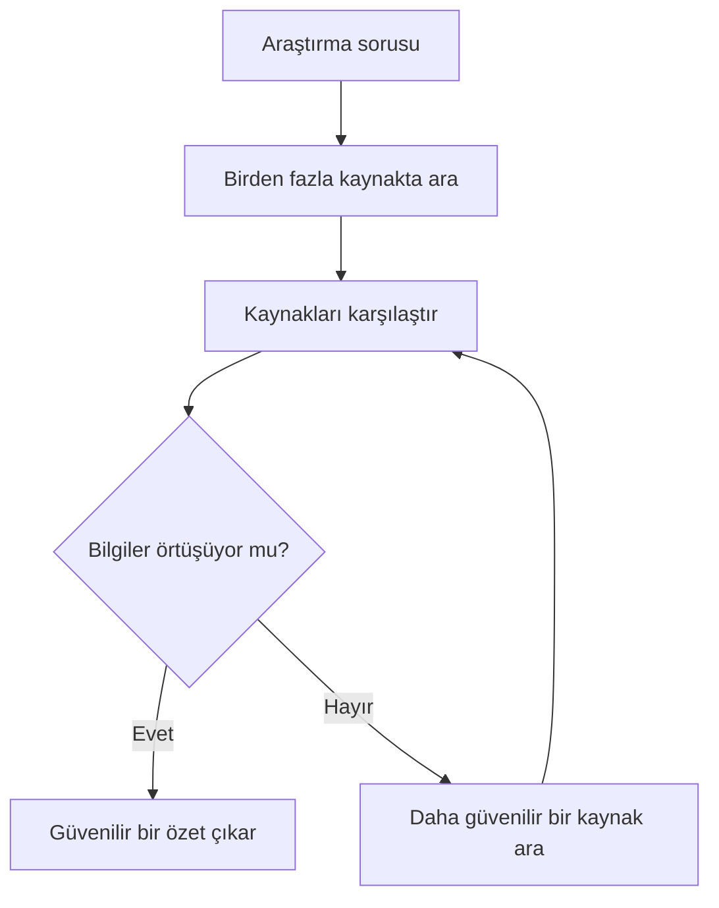

# Araştırma ve Üretkenlik Araçları

## 🎯 Bu Bölümde Ne Öğreneceğiz?

- Araştırma ve üretkenlik araçlarını tanıyacaksın.
- Birden fazla kaynaktan bilgi toplayıp kaynakları karşılaştıracaksın.
- Karşılaştırmalı bir özet çıkaracaksın.
- Kaynak gösterimini ve doğrulamayı uygulayacaksın.

## 💡 Neden Bu Konuyu Öğreniyoruz?

Bir konuyu araştırırken tek bir kaynağa güvenmek risklidir. Üretken yapay zekâ, bu süreci hızlandırmak için güçlü bir yardımcı olabilir; ancak yalnızca doğru kullanıldığında. Bu bölümde, bilgi toplama, kaynak karşılaştırma ve özet çıkarma işlerini doğrulama alışkanlığıyla birleştirmeyi öğreneceksin.

## Ön Bilgi

Bölüm 3'te doğrulamayı, Bölüm 4'te metin araçlarıyla özet çıkarmayı öğrendin. Bu bölüm, ikisini birleştirir.

## Temel Kavramlar

İki tür araç bu bölümün merkezindedir:

| Araç | Ne yapar? | Tipik kullanım |
|---|---|---|
| Perplexity | İnternette arama yapar ve yanıtı kaynaklarla birlikte sunar | Güncel bir konuyu hızlıca araştırmak |
| NotebookLM | Yüklediğin kendi belgelerinden yararlanır | Ders notlarından soru sormak ve özet almak |

Burada anahtar kavram **kaynaklı yanıt**tır: Araç, yanıtı verirken hangi kaynaklardan yararlandığını gösterir. Bu önemlidir; çünkü Bölüm 3'te öğrendiğin doğrulama adımını kolaylaştırır. Ancak kaynağın gösterilmesi, yanıtın kesin doğru olduğu anlamına gelmez; kaynağı yine de kontrol etmelisin.

Güvenilir bir araştırma akışı şöyledir:

Kaynakları karşılaştırırken şu soruları sor:

- **Örtüşme:** Farklı kaynaklar aynı bilgiyi veriyor mu?
- **Tarih:** Kaynak güncel mi?
- **Yetkinlik:** Kaynağı hazırlayan taraf konunun uzmanı mı?
- **Amaç:** Kaynağın bir çıkarı var mı (reklam, satış)?

## 🔍 Birlikte Keşfedelim

Bu keşifte, kaynakların örtüşüp örtüşmediğini göreceksin.

1. Bir araştırma sorusu seç. Örneğin: "Günde kaç kez diş fırçalamak önerilir?"
2. Aynı soruyu bir araştırma aracına (örneğin Perplexity) sor.
3. Aracın gösterdiği kaynakları incele.
4. **Tahminin:** Farklı kaynaklar aynı sayıyı mı verecek, yoksa farklı öneriler mi çıkacak? Yaz.
5. Cevabı en az bir bağımsız kaynaktan kontrol et.

**Ne gözlemledin?** Kaynaklar çoğu zaman örtüşür; ama bazen farklı öneriler de çıkabilir. Kaynakları karşılaştırmak, tek bir cümleye körü körüne güvenmekten çok daha güvenlidir.

## 🛠️ Uygulama

Şimdi kendi belgelerinden yararlanan bir aracı deneyeceksin.

1. Kitaptan ya da ders notundan kısa bir metin (birkaç paragraf) hazırla.
2. NotebookLM gibi bir aracı aç ve metni yükle.
3. Araca şu soruyu sor: "Bu metnin ana fikri nedir?"
4. Gelen özeti, metnin kendisiyle karşılaştır: Özet, metne sadık mı? Eklenmiş yanlış bir bilgi var mı?

Bu görevde, aracın yalnızca senin verdiğin belgeye dayandığını göreceksin. Bu, genel bir sohbet aracından farklıdır: Burada içerik, senin getirdiğin kaynaktan gelir.

## 🧪 Deneyelim ve Gözlemleyelim

Bu deneyde, kaynaklı yanıtın doğrulanmasını gözlemleyeceksin.

1. Bir araştırma aracına güncel bir konu hakkında soru sor (örneğin güncel bir sağlık önerisi).
2. Yanıtın yanında verilen kaynak bağlantılarına bak.
3. Kaynaklardan birini aç ve yanıttaki bilginin gerçekten orada olup olmadığını kontrol et.

**Tahmin ve gözlem:** Yanıt, kaynağı doğru yansıtıyor mu? Bazen yanıt, kaynağı doğru biçimde özetler; bazen ise kaynağın söylemediği bir şeyi ekler. Bu yüzden "kaynak gösterildi" demek, "doğrulandı" demek değildir.

## 🧰 Bir Şeyler Ters Giderse

Araştırma araçlarında sık karşılaşılan durumlar:

- **Kaynak gösterilmiyor.** Yanıtı doğrulamak zorlaşır; bir doğrulama adımı olmadan bu yanıta güvenme.
- **Kaynak açılmıyor ya da erişilemiyor.** Başka bir kaynaktan aynı bilgiyi kontrol et.
- **Kaynaklar birbiriyle çelişiyor.** En güncel ve en yetkin kaynağı tercih et; çelişkiyi not et.
- **Özet, belgeye yeni bilgi ekliyor.** Belgeye sadık bir özet iste; "yalnızca belgedeki bilgileri kullan" diye belirt.

## ✍️ Kendin Dene

Kendi derslerinden bir konuyu seç ve **karşılaştırmalı bir özet** hazırla.

1. Konuyu en az iki farklı kaynaktan araştır.
2. Bilgilerin örtüşüp örtüşmediğini not et.
3. Ortak ve ayrı noktaları içeren kısa bir özet yaz.
4. Özetin sonuna yararlandığın kaynakları listele.

İpucu

Bir özet, "kaynakların ortak söylediği" ile "yalnızca bir kaynağın söylediği" bilgileri ayırırsa daha güvenilirdir. Çelişen noktaları gizleme; açıkça belirt.

Çözüm

Beklenen çıktı, en az iki kaynağa dayanan, kaynakların örtüştüğü ve ayrıldığı noktaları gösteren ve kaynakları listeleyen bir özettir. Bu süreçte üç beceri birleşir: bilgi toplama, karşılaştırma ve doğrulama.

## ❓ Öğrendiklerini Kontrol Et

1. Kaynaklı yanıt nedir? Neden yararlıdır?
2. Perplexity ile NotebookLM arasındaki temel fark nedir?
3. Kaynakları karşılaştırırken sorulacak iki soruyu yaz.
4. "Kaynak gösterildi" demek neden "doğrulandı" anlamına gelmez?

Cevapları göster

1. Aracın, yanıtı verirken hangi kaynaklardan yararlandığını göstermesidir. Doğrulama adımını kolaylaştırır.
2. Perplexity internette arama yapar ve kaynaklı yanıt sunar; NotebookLM ise yüklediğin kendi belgelerine dayanır.
3. Örneğin: "Kaynaklar aynı bilgiyi veriyor mu?", "Kaynak güncel mi?". (Yetkinlik ve amaç da kabul edilir.)
4. Çünkü yanıt, kaynağı doğru biçimde yansıtmayabilir; kaynağın söylemediği bir şeyi ekleyebilir. Kaynağı açıp kontrol etmek gerekir.

## 🧭 Daha Fazlasını Öğrenmek

- Kullandığın araştırma aracının resmî **yardım merkezi**, kaynakların nasıl seçildiğini ve nasıl gösterildiğini açıklar.
- Bir sonraki bölümde, tüm bu araçları kullanırken dikkat etmen gereken **etik ilkeleri ve veri gizliliğini** ele alacağız.

## 📌 Kısa Özet

- Araştırma ve üretkenlik araçları, bilgi toplamayı ve özet çıkarmayı hızlandırır.
- Kaynaklı yanıt, doğrulamayı kolaylaştırır ama tek başına yeterli değildir.
- Bilgileri birden fazla kaynaktan karşılaştırmak gerekir.
- Kaynaklar çeliştiğinde en güncel ve en yetkin kaynak tercih edilir.
- İyi bir özet, ortak ve ayrı noktaları ayırır ve kaynakları listeler.

---
[Önceki Bölüm](08-Audio-Video-Generation.md) | [Kurs Ana Sayfası](../README.md) | [Sonraki Bölüm](10-Ethics-And-Privacy.md)
