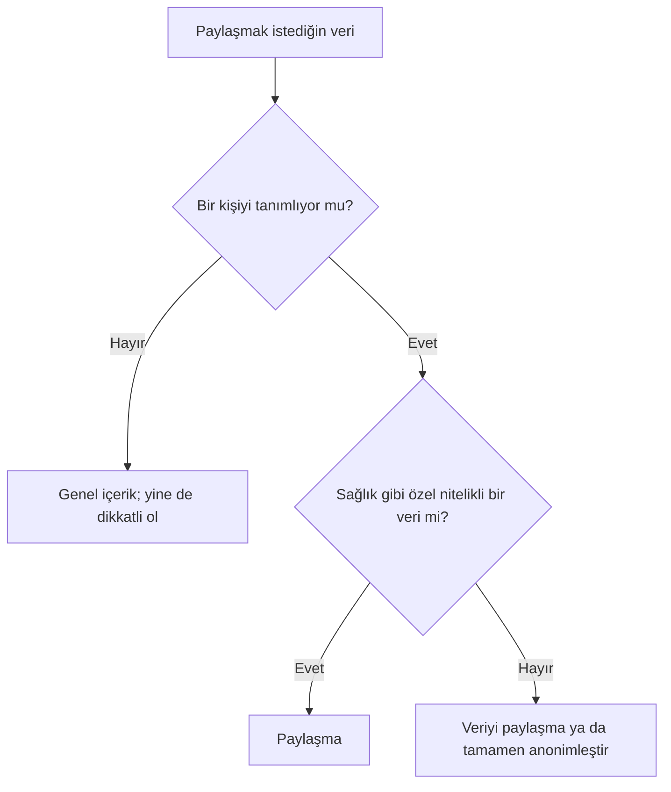

# Etik, Akademik Dürüstlük ve Veri Gizliliği

## 🎯 Bu Bölümde Ne Öğreneceğiz?

- Yapay zekâ kullanımında temel etik ilkeleri açıklayacaksın.
- Akademik dürüstlük kurallarını ve yapay zekâ kullanımını açıklama gereğini anlayacaksın.
- Kişisel veri ve gizlilik kavramlarını açıklayacaksın.
- Hasta verisi içeren bir senaryoda hangi verinin paylaşılmaması gerektiğini belirleyeceksin.

## 💡 Neden Bu Konuyu Öğreniyoruz?

Üretken yapay zekâ güçlü bir araçtır; ama güçlü araçlar sorumluluk da getirir. Bir ödevde kullandığın yapay zekâ, akademik dürüstlük kurallarına takılabilir. Bir hastaya ait bilgiyi bir sohbet aracına yazmak, gizliliği ihlal edebilir. Bu bölüm, aracı kullanırken hangi sınırlara dikkat etmen gerektiğini gösterir.

## Ön Bilgi

Bölüm 8'de kişisel ses ve görüntünün izinsiz kullanımının derin sahte anlamına geldiğini gördün. Bu bölüm, etik ve gizlilik konularını daha geniş biçimde ele alır.

## Temel Kavramlar

Yapay zekâ kullanımında şu etik ilkeler yol gösterir:

- **Dürüstlük:** Aracın katkısını gizleme; neyi kendin, neyi araçla yaptığını belirt.
- **Şeffaflık:** Gerektiğinde "bu metni hazırlarken yapay zekâdan yararlandım" diyebilirsin.
- **Sorumluluk:** Nihai sorumluluk sende. Çıktı yanlışsa, bu yanlışlık senin adına olur.
- **Zarar vermeme:** Başkalarına zarar verebilecek içerik üretme.
- **Adalet:** Ayrımcı ya da önyargılı içeriği fark et ve düzelt. (Bu konuyu Bölüm 11'de ayrıntılı işleyeceğiz.)

**Akademik dürüstlük**, kendi emeğini doğru biçimde temsil etmeyi gerektirir. Yapay zekâ kullanımının ölçüsü kurumdan kuruma değişir; bazı kurumlar serbest bırakır, bazıları yasaklar, bazıları ise yalnızca açıklama şartıyla izin verir. Bu yüzden ilk adım, **kendi kurumunun kuralını öğrenmektir**.

> [!IMPORTANT]
> Yapay zekâ ile üretilmiş bir metni, kendi yazdığın bir metin gibi sunmak intihaldir. Kural, içeriğin kimden geldiğini dürüstçe belirtmektir. Kullanım serbest olsa bile çoğu zaman **açıklama** beklenir.

**Kişisel veri**, bir kişiyi tanımlayan her türlü bilgidir: ad, soyad, kimlik numarası, adres, iletişim bilgisi, fotoğraf. Sağlık bilgileri ise **özel nitelikli** veridir; yani daha sıkı korunur. Türkiye'de kişisel veriler **KVKK** ile, Avrupa Birliği'nde ise **GDPR** ile korunur. Bu bölümde amaç, bu düzenlemelerin ayrıntısını ezberlemek değil; temel mantığını kavramaktır: **Bir kişiye ait veriyi, o kişinin izni olmadan üçüncü bir tarafa — ki bu bir yapay zekâ aracı da olabilir — vermemelisin.**

Şu soruları sorarak karar verebilirsin:

## 🔍 Birlikte Keşfedelim

Aşağıdaki senaryoyu incele ve karar ver.

> Bir öğrenci, aldığı bir ders için gerçek bir hasta vakasını özetlemek istiyor. Vakayı bir sohbet aracına yazıp "bunu özetle" demeyi planlıyor. Vakada hastanın adı, yaşı ve tedavi ayrıntıları var.

1. **Tahminin:** Bu öğrenci vakayı olduğu gibi paylaşmalı mı? Neden? Cevabını yaz.
2. Ardından aşağıdaki açıklamayı oku.

**Açıklama:** Öğrenci, hastaya ait veriyi paylaşmamalıdır. Çünkü hasta, bir yapay zekâ aracına veri aktarılmasına izin vermemiştir. Doğru yol, veriyi tamamen anonimleştirmek (kimseyi tanımlamayan hâle getirmek) ya da gerçek veri yerine kurgusal bir örnek kullanmaktır. Unutma: Bir araca yazdığın veri, aracın sunucularına gitmiş olur.

## 🛠️ Uygulama

Şimdi, kişisel veri içeren bir istemi güvenli hâle dönüştüreceksin.

1. Şu istemi ele al: "Ayşe Yılmaz, 34 yaşında, 12 numaralı dişinde ağrı var. Bu durum için bir takip planı yaz."
2. İstemde hangi bilgiler kişiyi tanımlıyor? İşaretle.
3. İstemi, kişisel veri içermeyecek biçimde yeniden yaz.
4. Yazdığın yeni istemi oku: Artık bir kişiyi tanımlıyor mu?

Bu uygulamada öğrendiğin şu: Aynı görevi, kişisel veriyi çıkardıktan sonra da yerine getirebilirsin. Bilgi ihtiyacın çoğu zaman ayrıntılı kimlik bilgisi gerektirmez.

## 🧰 Bir Şeyler Ters Giderse

- **Yanlışlıkla kişisel veri paylaştın.** Aracın veri saklama ve silme politikasını kontrol et; gerekirse sohbeti sil. Bundan sonrası için veriyi anonimleştirme alışkanlığı edin.
- **Ödevinde yapay zekâ kullanıp kullanmadığından emin değilsin.** Kurumunun kuralını oku. Kural belirsizse, kullanımını açıkça belirtmek en güvenli yoldur.
- **Bir çıktı ayrımcı görünüyor.** İçeriği kullanma; çıktıyı eleştir ve düzeltilmesini iste. (Bölüm 11'de bunu sistemli yapacağız.)
- **Emin değilsin.** Şüphe duyduğunda paylaşmamayı seç. Gizlilikte temel kural: Emin değilsen paylaşma.

## ✍️ Kendin Dene

Bir ödevinde yapay zekâdan yararlandığını varsay. Bunu **dürüstçe** nasıl açıklayacağını gösteren kısa bir "kullanım notu" yaz.

1. Hangi görevde yararlandığını belirt.
2. Neyi araçla ürettiğini, neyi kendin düzenlediğini yaz.
3. Çıktıyı nasıl doğruladığını ekle.

İpucu

İyi bir kullanım notu kısa ve açıktır. Amaç, aracı "itiraf etmek" değil; katkıyı şeffaf biçimde göstermektir. Örneğin: "Bu özetin ilk taslağını bir yapay zekâ aracıyla oluşturdum, ardından ders kitabından doğrulayıp kendi cümlelerimle yeniden yazdım."

Çözüm

Beklenen çıktı, aracın hangi görevde ve nasıl kullanıldığını, çıktının nasıl doğrulandığını ve son sözün kendinde olduğunu gösteren dürüst bir nottur. Böyle bir not, hem şeffaflık hem akademik dürüstlük ilkelerini karşılar.

## ❓ Öğrendiklerini Kontrol Et

1. Yapay zekâ kullanımında üç etik ilkeyi yaz.
2. Yapay zekâ ile üretilmiş bir metni kendi metnin gibi sunmak neden sorunludur?
3. Kişisel veri nedir? Bir örnek ver.
4. Bir hasta vakasını yapay zekâya özetletmek isteyen öğrenci ne yapmalıdır?

Cevapları göster

1. Örneğin: dürüstlük, şeffaflık, sorumluluk. (Zarar vermeme ve adalet de kabul edilir.)
2. Çünkü bu, intihaldir; içeriğin kimden geldiğini gizlemek akademik dürüstlük kurallarını ihlal eder.
3. Bir kişiyi tanımlayan her türlü bilgidir. Örneğin ad, kimlik numarası veya adres.
4. Veriyi tamamen anonimleştirmeli ya da gerçek vaka yerine kurgusal bir örnek kullanmalıdır. Hastaya ait veriyi olduğu gibi paylaşmamalıdır.

## 🧭 Daha Fazlasını Öğrenmek

- Kurumunun **akademik dürüstlük yönergesini** oku; yapay zekâ kullanımıyla ilgili maddeleri ara.
- Türkiye'de kişisel verilerin korunmasına ilişkin resmî düzenleme metinlerine, ilgili resmî kurumun sayfalarından ulaşabilirsin. Avrupa Birliği için GDPR'ın resmî bilgi sayfaları yol göstericidir.
- Bir sonraki bölümde önyargı, telif ve eleştirel değerlendirme konularına geçiyoruz.

## 📌 Kısa Özet

- Yapay zekâ kullanımının etik temeli dürüstlük, şeffaflık, sorumluluk, zarar vermeme ve adalettir.
- Akademik dürüstlük, kullanılan yapay zekâyı açıklamayı gerektirir; kural kurumdan kuruma değişir.
- Kişisel veri ve özellikle sağlık verisi, izinsiz paylaşılmamalıdır.
- Hasta verisi yerine anonim ya da kurgusal örnek kullan.
- Emin değilsen paylaşmamayı seç.

---
[Önceki Bölüm](09-Research-Productivity-Tools.md) | [Kurs Ana Sayfası](../README.md) | [Sonraki Bölüm](11-Critical-Evaluation.md)
