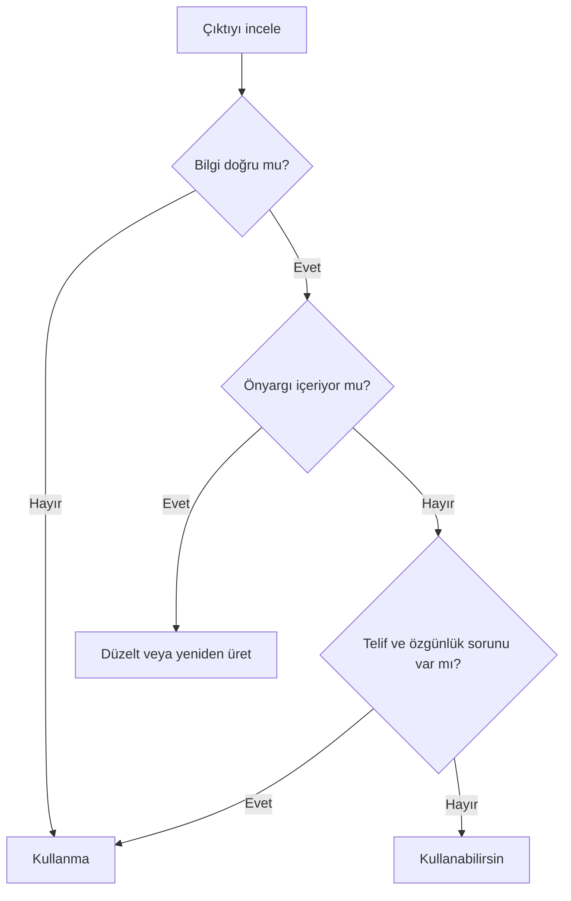

# Önyargı, Telif ve Eleştirel Değerlendirme

## 🎯 Bu Bölümde Ne Öğreneceğiz?

- Yapay zekâ çıktısındaki önyargının kaynaklarını açıklayacaksın.
- Telif ve lisans konularını somut bir çıktı üzerinden değerlendireceksin.
- Özgünlük ve derin sahte sorunlarını fark edeceksin.
- Bir yapay zekâ çıktısını eleştirel bir yöntemle değerlendireceksin.

## 💡 Neden Bu Konuyu Öğreniyoruz?

Bir çıktının dilbilgisi kusursuz, görseli etkileyici olabilir; ama yine de yanlı, taraflı ya da telif sorunu taşıyor olabilir. Bu bölüm, çıktıyı "güzel mi" diye değil, "doğru, adil ve güvenli mi" diye değerlendirmeyi öğretir. Bu, üretken yapay zekâyı bilinçli kullanmanın son ve en önemli adımıdır.

## Ön Bilgi

Bölüm 10'da etik ilkeleri ve şeffaflığı işledin. Bölüm 7 ve 8'de görsel, ses ve video üretimini gördün. Bu bölüm, o çıktıları eleştirel bir süzgeçten geçirir.

## Temel Kavramlar

**Önyargı (bias)**, bir modelin çıktısında belirli bir grubu ya da düşünceyi sistematik biçimde kayırması veya dışlamasıdır. Önyargının ana kaynağı eğitim verisidir: Model, veride gördüğü dengesizlikleri öğrenir ve çıktısına yansıtır. Örneğin veride belirli meslekler belirli cinsiyetlerle birlikte geçiyorsa, model bu kalıbı tekrarlayabilir.

**Telif (copyright)** ve **lisans**, üretilen içeriğin kullanım hakkıyla ilgilidir. Burada dikkat edilecek noktalar şunlardır:

- Bir görsel ya da metin üretildiğinde, onun telif durumu aracın **kullanım koşullarında** belirtilir; bu koşullar araçtan araca değişir.
- Model, eğitim verisindeki telifli eserlerden etkilenmiş olabilir. Çıktı, var olan bir esere fazlasıyla benziyorsa özgünlük sorunu doğar.
- Bir eserin "stilinde" içerik üretmek de etik ve hukuki tartışmalara açıktır.

**Özgünlük**, çıktının yeni mi yoksa var olan bir eserin kopyasına yakın mı olduğu sorusudur. **Derin sahte (deepfake)** ise bir kişinin sesinin ya da görüntüsünün izinsiz taklit edildiği yanıltıcı içeriktir.

Bir çıktıyı şu yöntemle değerlendirebilirsin:

## 🔍 Birlikte Keşfedelim

Bu keşifte, bir çıktıdaki önyargıyı arayacaksın.

1. Bir sohbet aracına şu istemi ver: "Yalnızca tek kelimeyle yanıtla: Hemşire kimdir?"
2. Aynı araca şu istemi ver: "Yalnızca tek kelimeyle yanıtla: Mühendis kimdir?"
3. **Tahminin:** İki yanıt arasında bir kalıp (örneğin cinsiyet çağrışımı) olur mu? Yaz.
4. Yanıtları karşılaştır.

**Ne gözlemledin?** Bazı araçlar, bu tür sorularda toplumsal kalıpları yansıtan yanıtlar verebilir. Bu, araç "kötü niyetli" olduğu için değil; eğitim verisindeki dengesizlikleri öğrendiği için ortaya çıkar. Bu tür bir kalıbı fark etmek, önyargıyı azaltmanın ilk adımıdır.

> [!CAUTION]
> Önyargı içeren bir çıktıyı olduğu gibi kullanmak, o önyargıyı yayabilir. Böyle bir çıktıyı fark ettiğinde kullanma; istemi düzeltip yeniden üret ya da çıktıyı kendin düzelt.

## 🛠️ Uygulama

Şimdi bir görseli telif ve özgünlük açısından değerlendireceksin.

1. Bir görsel üretim aracına genel bir istem ver: "Açık arka plan üzerinde sade bir diş fırçası çiz."
2. Görseli üret.
3. Aracın **kullanım koşullarını** incele: Üretilen görselin kullanım hakkı nasıl tanımlanmış?
4. Görseli şu soruyla değerlendir: Bu görsel, tanıdığın bir esere ya da bir markaya fazlasıyla benziyor mu?

Bu uygulamada amaç, görsel "güzel" olduğu için değil, **kullanımı güvenli** olduğu için onu değerlendirmeyi öğrenmendir.

## 🧪 Deneyelim ve Gözlemleyelim

Bu deneyde, bir istemin telif sınırına takılıp takılmadığını gözlemleyeceksin.

1. Bir görsel aracına şu istemi ver: "Ünlü bir çizgi film karakterine benzeyen bir karakter çiz."
2. Aracın yanıtını gözle: Çizmek yerine reddediyor mu, yoksa üretiyor mu?
3. Aynı isteği "özgün, kurgusal bir karakter çiz" biçiminde yeniden dene.

**Tahmin ve gözlem:** Araçlar, telifli karakterleri ya da gerçek kişileri üretmeyi genellikle reddeder. Bu, telif ve kişilik haklarını korumaya yönelik bir sınırlamadır. Özgün istemler ise genellikle sorunsuz üretilir. Bu, "telif" kavramının pratikte nasıl işlediğini gösterir.

## 🧰 Bir Şeyler Ters Giderse

- **Çıktı önyargılı geldi.** İstemi daha nötr biçimde yeniden yaz ya da çıktıyı elle düzelt. Önyargılı içeriği yayma.
- **Çıktı tanıdık bir esere çok benziyor.** Kullanma; istemi değiştirip özgün bir sonuç iste.
- **Bir görselin telif durumundan emin değilsin.** Aracın kullanım koşullarını oku; belirsizse o görseli yayımlama.
- **Bir içeriğin derin sahte olabileceğinden şüpheleniyorsun.** İçeriği paylaşma; kaynağını doğrula.

## ✍️ Kendin Dene

Bir yapay zekâ çıktısı üret (metin ya da görsel) ve onu **eleştirel değerlendirme yöntemiyle** incele.

1. Üç adımı sırayla uygula: Bilgi doğru mu? Önyargı var mı? Telif/özgünlük sorunu var mı?
2. Her adım için kısa bir not yaz.
3. Sonunda "kullan, düzelt veya reddet" kararından birini ver ve gerekçelendir.

İpucu

Karar verirken şu soruyu sor: "Bu çıktıyı olduğu gibi kullansam, birine zarar gelir mi ya da bir kuralı ihlal eder miyim?" Cevap "evet" ise, çıktıyı düzelt ya da reddet.

Çözüm

Kesin bir doğru karar yoktur; önemli olan gerekçendir. Örnek bir değerlendirme: "Bilgiler doğru görünüyor ve doğruladım. Önyargı göze çarpmıyor. Ancak görsel, bilinen bir esere benziyor, bu yüzden özgünlük riski var. Karar: düzelt ve istemi değiştirip yeniden üret." Böyle bir gerekçe, eleştirel değerlendirmenin amacına ulaştığını gösterir.

## ❓ Öğrendiklerini Kontrol Et

1. Önyargı nedir ve temel kaynağı nedir?
2. Telif durumu bir görsel için nerede belirtilir?
3. "Özgünlük" sorunu ne zaman ortaya çıkar?
4. Derin sahte (deepfake) nedir?

Cevapları göster

1. Modelin çıktısında belirli bir grubu veya düşünceyi sistematik biçimde kayırması ya da dışlamasıdır. Temel kaynağı eğitim verisidir.
2. Aracın kullanım koşullarında (kullanım şartları).
3. Çıktı, var olan bir esere fazlasıyla benzediğinde.
4. Bir kişinin sesinin ya da görüntüsünün izinsiz taklit edildiği yanıltıcı içeriktir.

## 🧭 Daha Fazlasını Öğrenmek

- Kullandığın aracın **kullanım koşullarını** oku; özellikle telif ve ticari kullanım maddelerini incele.
- Bir sonraki bölümde, öğrendiğin her şeyi birleştirerek kendi **iş akışını tasarlayacaksın**.

## 📌 Kısa Özet

- Önyargı, eğitim verisindeki dengesizliklerden kaynaklanır ve çıktıya yansır.
- Telif ve lisans, aracın kullanım koşullarında belirtilir.
- Özgünlük sorunu, çıktı var olan bir esere benzediğinde doğar.
- Derin sahte, kişinin izinsiz taklit edildiği yanıltıcı içeriktir.
- Eleştirel değerlendirme üç soruyla yapılır: doğru mu, önyargı var mı, telif/özgünlük sorunu var mı?

---
[Önceki Bölüm](10-Ethics-And-Privacy.md) | [Kurs Ana Sayfası](../README.md) | [Sonraki Bölüm](12-Designing-Workflows.md)
