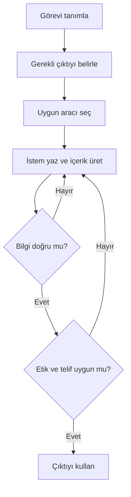

# Kendi İş Akışını Tasarlama

## 🎯 Bu Bölümde Ne Öğreneceğiz?

- Bir görevi analiz edip o göreve uygun araçları seçeceksin.
- Doğrulama ve etik kontrol noktaları içeren bir iş akışı tasarlayacaksın.
- Tasarladığın iş akışını uygulayacak ve değerlendireceksin.
- Kurs bittikten sonra öğrenmeye nasıl devam edeceğini planlayacaksın.

## 💡 Neden Bu Konuyu Öğreniyoruz?

Şimdiye kadar tek tek araçları, istem yazmayı, doğrulamayı ve etiği öğrendin. Gerçek hayatta bu parçalar ayrı ayrı değil, bir **iş akışı** içinde birlikte kullanılır. Bir görevi baştan sona doğru araçlarla, doğrulama ve etik kontrol noktalarıyla planlayabilen bir kişi, araçları rastgele kullanan bir kişiden çok daha güvenilir sonuç üretir.

## Ön Bilgi

Bu bölüm, kursun tüm önceki bölümlerini birleştirir: kavramlar (1-3), araçlar ve istem (4-9), etik ve eleştirel değerlendirme (10-11).

## Temel Kavramlar

**İş akışı (workflow)**, bir görevi baştan sona tamamlamak için izlenen adımlar dizisidir. Üretken yapay zekâ ile çalışırken iyi bir iş akışı, üretimi doğrulama ve etik kontrolle birlikte planlar. Genel iskelet şöyledir:

Bu iskeletin önemli özelliği, **iki kontrol noktası** içermesidir:

- **Doğrulama kontrolü:** Üretilen bilgi bağımsız kaynaklarla doğrulanır (Bölüm 3 ve 9).
- **Etik kontrol:** Önyargı, telif, özgünlük ve gizlilik açısından bir sorun olup olmadığı değerlendirilir (Bölüm 10 ve 11).

Bir iş akışı tasarlarken şu soruları yanıtla:

- **Görev ne?** Tek cümleyle ne yapmak istiyorum?
- **Çıktı ne olmalı?** Metin mi, görsel mi, ses mi? Hangi biçimde?
- **Hangi araç uygun?** Bu görev için metin, görsel, ses ya da araştırma aracı mı gerekli?
- **Nasıl doğrularım?** Hangi bilgiyi, hangi bağımsız kaynaktan kontrol edeceğim?
- **Etik açıdan neye dikkat etmeliyim?** Kişisel veri var mı? Telif riski var mı?

Örnek bir alan uygulaması düşünelim: Bir diş hekimliği öğrencisi, bir sunum için "ağız bakımı" konulu kısa bir tanıtım metni ve bir görsel hazırlamak istiyor.

1. **Görev:** Tanıtım metni ve görsel hazırlamak.
2. **Çıktı:** Üç paragraflık metin ve tek bir görsel.
3. **Araç seçimi:** Metin için sohbet aracı; görsel için görsel üretim aracı.
4. **Doğrulama:** Metindeki sağlık bilgilerini güvenilir bir kaynaktan kontrol etmek.
5. **Etik kontrol:** Kişisel veri olmadığından; görselin telif ve özgünlük açısından uygun olduğundan emin olmak.

## 🔍 Birlikte Keşfedelim

Aşağıdaki görevleri incele. Her biri için hangi araç türünün (metin, görsel, ses/video, araştırma) uygun olduğunu ve hangi kontrol noktasının gerektiğini tahmin et.

1. Bir konferans için kısa bir tanıtım afişi hazırlamak.
2. Şekerli içeceklerin diş sağlığına etkisi hakkında güncel bilgi toplamak.
3. Bir ders sunumu için konuşma metnini seslendirmek.
4. Kendi ders notlarından bir konunun özetini çıkarmak.

**Tahminin:** Her görev için aracı ve kontrol noktasını yaz. Sonra aşağıyı oku.

**Açıklama:**

1. **Afiş:** Görsel üretim aracı uygun. Kontrol: telif ve özgünlük; ayrıca görselde yazı kullanma.
2. **Güncel bilgi:** Araştırma aracı uygun. Kontrol: kaynakların örtüşmesi ve doğrulama.
3. **Seslendirme:** Ses üretim aracı uygun. Kontrol: kişisel ses taklidi yapmadığından emin olmak; doğallık.
4. **Özet:** Kendi belgelerine dayanan üretkenlik aracı uygun. Kontrol: özetin belgeye sadık olması.

## 🛠️ Uygulama

Şimdi kendi alanından bir görev için iş akışı tasarlayacaksın.

1. Görevini tek cümleyle tanımla (örneğin "hastaya ağız bakımı broşürü hazırlamak").
2. Beş soruyu (görev, çıktı, araç, doğrulama, etik) yanıtla.
3. İş akışını adım adım yaz.
4. Adımlardan en az birini gerçek bir araçla uygula.
5. Sonucu, tasarladığın kontrol noktalarından geçir.

Bu uygulamada amaç, tek bir araç kullanmak değil; **görevi baştan sona planlamak**tır.

## ✍️ Kendin Dene

Bu bölümün bitiş görevi, kursun tamamını birleştirir.

1. Kendi alanından gerçek bir görev seç (sunum, broşür, özet, tanıtım, çalışma notu).
2. İş akışını tasarla: Araçları, doğrulama adımını ve etik kontrolü belirle.
3. İş akışını uçtan uca uygula: içeriği üret, doğrula, etik açıdan değerlendir.
4. Sonucu ve süreci kısa bir metinle raporla: Neyi öğrendin, nerede zorlandın, neyi farklı yapardın?

İpucu

İş akışını uygularken bir "hata günlüğü" tut. Karşılaştığın sorunları ve çözümlerini not et. Bu günlük, hem bu görevde hem de gelecekteki görevlerinde en değerli kaynağın olur.

Çözüm

Beklenen çıktı, tanımlı bir görev, seçilmiş araçlar, uygulanmış doğrulama ve etik kontrolü ve dürüst bir öz değerlendirme içeren bir iş akışıdır. Önemli ölçüt, akışın iki kontrol noktasını (doğrulama ve etik) içermesidir. Bu iki nokta olmadan iş akışı eksiktir.

## ❓ Öğrendiklerini Kontrol Et

1. Bir iş akışının içermesi gereken iki kontrol noktası nedir?
2. Bir iş akışı tasarlarken sorulacak üç soruyu yaz.
3. Neden araçları tek tek kullanmak yerine bir iş akışı içinde planlamak daha güvenilirdir?
4. Kurs bittikten sonra öğrenmeye devam etmek için ne yapabilirsin?

Cevapları göster

1. Bilgi doğrulama kontrolü ve etik/telif kontrolü.
2. Örneğin: Görev ne? Çıktı ne olmalı? Hangi araç uygun? (Nasıl doğrularım? ve etik açıdan neye dikkat etmeliyim? de kabul edilir.)
3. Çünkü iş akışı, üretimi doğrulama ve etik kontrolle birleştirir; rastgele kullanımda bu adımlar genellikle atlanır ve yanlış ya da sorunlu çıktılar fark edilmeden kullanılır.
4. Örneğin: Araçların resmî yardım merkezlerini izlemek, yeni teknikleri küçük görevlerde denemek ve karşılaştığı sorunları bir hata günlüğünde biriktirmek.

## 🧭 Daha Fazlasını Öğrenmek

- Araçların resmî **yardım merkezlerini** ve **kullanım koşullarını** düzenli aralıklarla gözden geçir; özellikler ve sınırlar zamanla değişir.
- Kurumunun akademik dürüstlük ve veri gizliliği kurallarını, konu gündeme geldikçe yeniden oku.
- En iyi öğrenme yolu denemektir: Her yeni tekniği önce küçük, riski düşük bir görevde dene; sonra gerçek görevlerine taşı.

## 📌 Kısa Özet

- İş akışı, bir görevi doğrulama ve etik kontrolle birlikte planlayan adımlar dizisidir.
- İyi bir iş akışı iki kontrol noktası içerir: doğrulama ve etik/telif.
- Araç seçimi, görevin ve çıktının niteliğine göre yapılır.
- İş akışını uygulamak, öğrendiklerini birleştirmenin en iyi yoludur.
- Öğrenme kursla bitmez; araçları izlemek ve denemeye devam etmek süreklidir.

---
[Önceki Bölüm](11-Critical-Evaluation.md) | [Kurs Ana Sayfası](../README.md)
